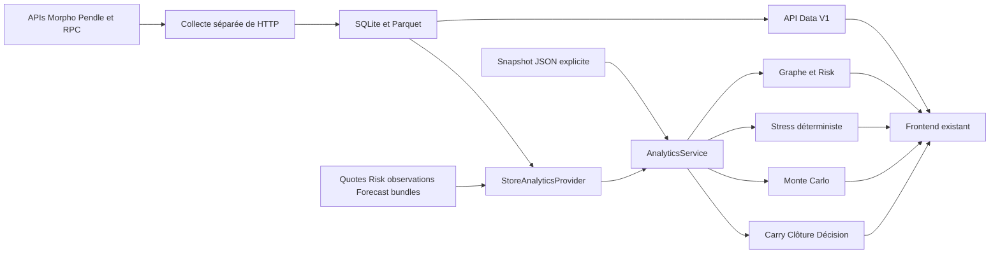

# DeFi Risk Radar — brief technique de raccordement frontend/backend

Référence : `main` au commit **737ee1b**, inspecté le 11 octobre 2026.
Destinataire : agent chargé d'adapter le frontend existant et de le brancher au backend.
Ce document décrit l'existant ; les propositions d'interface sont identifiées comme telles.

## 1. Mission et périmètre

Relier le frontend existant aux capacités réelles du backend, sans reconstruire
les moteurs et sans modifier les contrats Data V1 pour faciliter l'interface.
Conserver le design et les composants utiles. Ajuster navigation, formulaires,
cartes de résultats, graphes et états d'erreur lorsque le backend le nécessite.

Le produit analyse en lecture seule une position d'emprunt Morpho Blue dont le
collatéral est un PT Pendle. L'utilisateur doit pouvoir :

1. Choisir une stratégie et une position disponibles.
2. Comprendre ses dépendances et consulter leurs preuves.
3. Examiner santé financière, risque observable et données manquantes.
4. Simuler un choc explicite et voir ce qui est exposé, bloqué ou perdu.
5. Examiner le financement et les coûts nécessaires pour fermer la position.
6. Comparer conserver/sortir sous hypothèses, avec seuil de bascule et limites.
7. Explorer Monte Carlo ou demander une comparaison Predictive si les entrées existent.

Il ne s'agit pas d'un protocole qui gère des fonds : aucune transaction, signature,
approval, liquidation ou clôture réelle n'est exécutée par cette application.
Un bouton « EXIT » doit présenter un résultat ou un plan de sortie, jamais faire
croire que la position vient d'être vendue.

Le frontend externe évoqué par le propriétaire n'est pas présent comme projet
React/Next/Vite dans ce checkout : son code et son état réel n'ont pas été audités
ici. Faire son inventaire avant de proposer une refonte ou des dépendances.

## 2. Sources de vérité et annexes utilisables

Ordre de référence pour implémenter : code actuel et OpenAPI généré → exemples
exécutés → ce brief → anciens briefs. Certains anciens documents décrivent un
carry uniquement manuel, un stockage sans preuves par point ou un Core sans ML ;
ces formulations ne décrivent plus entièrement le code actuel.

- [OpenAPI complet exporté de cette version](openapi_backend_737ee1b.json) : 22 chemins API, paramètres, corps et modèles typés.
- [Schémas JSON des DTO Data V1](data_v1_schemas_737ee1b.json) : marchés, positions, stratégies, preuves, relations et séries.
- [13 appels et réponses JSON exécutés](api_examples_synthetic_737ee1b.json) : fixtures **synthétiques**, replay, pas de données live.
- [Parcours de démo exact](../demo/hero_path.md) : appels curl, identifiants et résultats attendus.
- [Implémentation Normal et clôture](../implementation/normal_backend.md).
- [Raccordement Monte Carlo](../implementation/monte_carlo_pr2.md).
- [Validation Predictive prospective](../implementation/marilou_predictive.md).
- [Livraison Data](../data/DATA_DELIVERY.md).
- [Protocole LLM local](../implementation/PROTOCOLE_LLM_STAY_EXIT.md) : proposition locale, fonctionnalité non implémentée.

Les exemples ont été produits avec TestClient, le vrai routeur et les moteurs,
un snapshot synthétique et un stockage temporaire isolé. L'OpenAPI exporté reste
un instantané : le `/openapi.json` du serveur utilisé en intégration prévaut si
la branche avance.

## 3. Stack et architecture

| Couche | Technologies et responsabilité |
| --- | --- |
| API | Python 3.13, FastAPI 0.143.0, Uvicorn 0.54.0 ; routes HTTP JSON en lecture seule |
| Contrats | Pydantic 2.14.0 ; modèles stricts, validations, sérialisation Decimal |
| Calculs | `decimal.Decimal` ; précision locale 60 dans les calculs financiers principaux |
| Graphe | NetworkX 3.7 ; dépendances, parcours inverse, cycles, exposition et chemins représentatifs |
| Data | SQLite pour DTO/preuves/relations ; Parquet avec pandas/pyarrow pour séries |
| Accès fournisseurs | Adaptateurs Morpho/Pendle, Ethereum RPC via Web3, DefiLlama, httpx/requests |
| Tests | pytest 9.1.1, FastAPI TestClient/httpx 0.28.1 ; tests isolés des fournisseurs |
| ML hors API | Package `ml/`, adaptateurs et benchmarks de modèles préentraînés, dépendances optionnelles séparées |
| Démo UI du dépôt | HTML autonome et JSON exporté ; ce n'est pas une application frontend connectée à toutes les APIs |

Les versions analytics sont fixées dans `backend/requirements-analytics.txt`, qui
inclut `backend/requirements.txt`. La liste Data contient aussi des dépendances
non épinglées ; ne pas présenter tout l'environnement comme verrouillé.
Aucune stack frontend n'est imposée par le backend. Garder celle de l'interface existante.



Les handlers Data/delivery lisent le stockage ; ils ne lancent pas une collecte
fournisseur sur clic. Les moteurs Core consomment un snapshot. La collecte et le
ML sont des traitements séparés ; un bouton de refresh UI recharge les données
stockées, sans garantir de nouvelles observations réseau.

## 4. État des fonctionnalités

| Partie | Implémentée | Ce que le frontend doit respecter |
| --- | --- | --- |
| Data | Marchés, stratégies, position par ID, séries, preuves, fraîcheur, rapport de livraison, devis cachés, incidents | Stores réels non versionnés ; une installation vide n'a pas automatiquement de données live |
| Graphe | Construction, preuves, liens incertains, propagation, fallback, exposition d'une dépendance | `PARTIAL` est un résultat utile, pas nécessairement une panne |
| Risk | Dix facteurs, cinq dimensions, couverture, confiance, santé par position | Score nullable, heuristique, jamais probabilité de crise |
| Stress | Oracle manipulation/outage, unauthorized minting, cross-chain | Exposition, capital bloqué et perte chiffrée sont différents |
| Carry Normal | Taux courants constants ou hypothèses explicites, coût d'emprunt, frais de détention | Projection conditionnelle ; refus à/au-delà de l'expiration PT |
| Closing | Remboursement → retrait → vente, financement, frais et reste net | Plan en lecture seule ; hypothèses distinctes d'un financement vérifié |
| STAY/EXIT | Comparaison, verdict, seuil de bascule, exclusions, cas inconnus | `verdict=null` est normal en cas d'égalité ou de comparaison impossible |
| Monte Carlo | GBM prix oracle, dette, calibration sur série RPC, métriques | Fréquence simulée sous modèle, pas probabilité observée ni perte réalisée |
| Predictive ML | Production/validation/export hors API, consommation de bundles par Decision | Modèle non exécuté dans la requête HTTP ; fallback Normal si bundle inutilisable |
| Explication LLM | Protocole seulement | Aucun endpoint LLM, aucune génération activée |
| Wallet et transactions | Pas de parcours de mutation livré | Ne pas rendre fonctionnels en apparence des boutons de clôture réelle |

Une fonctionnalité testée avec une fixture n'est pas une preuve de disponibilité
des entrées réelles. Un marché REAL peut porter une position SIMULATED. Les devis
et les prévisions ont des durées de validité courtes.

## 5. Installation et modes de lancement

Depuis la racine du dépôt :

```bash
python3.13 -m venv backend/.venv
backend/.venv/bin/python -m pip install -r backend/requirements-analytics.txt
backend/.venv/bin/python -m uvicorn app.main:app --app-dir backend --host 127.0.0.1 --port 8000
```

Documentation interactive : `http://127.0.0.1:8000/docs`.
Contrat vivant : `http://127.0.0.1:8000/openapi.json`.

| Variable | Effet |
| --- | --- |
| `DOMINO_DATA_DIR` | Racine des magasins Data ; défaut `backend/data` |
| `ANALYTICS_SNAPSHOT` | Injecte un snapshot pour les routes Core ; absent → stores |
| `ANALYTICS_REPLAY` | Évaluation au temps du snapshot ; défaut vrai avec snapshot, faux avec stores |
| `ANALYTICS_INPUTS` | Inputs Core facultatifs : quotes, observations Risk et bundles forecast |

`create_app` ne charge pas automatiquement un `.env`. Exporter les variables du
serveur ou utiliser la configuration du processus de lancement.

Pour commencer le raccordement sans dépendance réseau :

```bash
ANALYTICS_SNAPSHOT=backend/app/fixtures/analytics_demo.json ANALYTICS_REPLAY=true \
  backend/.venv/bin/python -m uvicorn app.main:app --app-dir backend --host 127.0.0.1 --port 8000
```

**Attention à la frontière snapshot/stores :** cette injection alimente Core,
pas automatiquement `/markets`, `/strategies`, `/positions`, `/series` ou
`/evidence`. Ces routes Data continuent de lire SQLite/Parquet. Pour un premier
écran Core synthétique, utiliser les IDs documentés et les preuves incluses dans
l'enveloppe Core. Pour tester tout le parcours Data, préparer aussi les stores,
via les scripts du dépôt dont `load_demo_fixture.py` ; consulter leur `--help`
avant de choisir le répertoire cible. Ne pas polluer les magasins REAL.

CORS actuel : `http://localhost:3000` et `http://localhost:5173`, méthodes GET/POST.
`http://127.0.0.1:5173` est une autre origine et n'est pas déjà autorisée.
Configurer l'origine réelle du frontend ou un proxy de développement. Ne pas
résoudre ce problème par un `*` global avec credentials. Le backend ne fournit
pas de session utilisateur ou d'authentification applicative ; prévoir la limite
avant de l'exposer publiquement. Aucune infrastructure de déploiement n'est
supposée déjà opérationnelle.

## 6. Formats communs : les pièges à éviter

### 6.1 Unités et identifiants

- Decimal JSON → chaîne : `"0.02"`, `"1200000"`. Garder les chaînes dans les types API ; convertir seulement pour affichage/graphique avec contrôles.
- Ratios → fractions : `0.02 = 2 %`, `0.8 = 80 %`. Les champs suffixés `_pct` sont déjà des pourcentages : ne pas multiplier deux fois.
- Montants → unités entières de tokens, pas valeurs brutes et pas nécessairement USD. Les `*_raw` sont des entiers on-chain distincts.
- HF = health factor sans unité ; LTV = ratio dette/valeur oracle ; LLTV = seuil de liquidation.
- Dates → ISO 8601 avec fuseau, normalement UTC. Montrer la date et le mode replay.
- Actif → adresse + chaîne, jamais symbole seul. MVP réseau Ethereum `chain_id=1`.
- Marché Data → `morpho:1:<bytes32>` ou `pendle:1:<adresse>` ; stratégie → `strat_...` ; position → `pos_...`.
- Nœud Graph → ID opaque reçu dans `nodes`. Encoder les paramètres avec `URLSearchParams`/`encodeURIComponent`, sans reconstruire les IDs par label.
- `null` signifie inconnu : afficher « Indisponible »/« Non déterminé », jamais `0`, `0 %` ou risque faible par défaut.

### 6.2 Trois informations indépendantes

| Information | Valeurs | Interprétation |
| --- | --- | --- |
| Origine Data | REAL / DEMO | Marché et preuves réels ou jeu synthétique |
| Type position | ONCHAIN / SIMULATED | Position observée ou montants hypothétiques |
| Horloge | Live / Replay | Fraîcheur évaluée maintenant ou à une date figée |

Les filtres `data_mode` sont globaux à un parcours. Changer de mode invalide les
résultats et simulations précédents. Avec un snapshot injecté, le service Core
est fixé par la configuration du serveur : le query param ne le transforme pas
en un autre dataset. Se fier aussi à la provenance renvoyée.

### 6.3 Deux familles d'enveloppes

Data V1 expose : `schema_version`, `status`, `as_of`, `snapshot` contenant le mode
et éventuellement le bloc, `data`, `provenance.source_ids/evidence_ids`,
`missing_fields`, `warnings`.

Core expose : `schema_version="analytics-v1.1"`, `status`, `as_of`, `data`,
`provenance.snapshot_id/data_modes/position_kinds/replay/evaluated_at/evidence`,
`missing_fields`, `warnings`. Les preuves sont des objets complets dans Core.

Ne pas imposer un seul type de provenance aux deux familles. Une adaptation
frontend commune peut conserver un discriminant de famille et les données brutes.
L'enveloppe Data utilise actuellement `data: Any` côté API : un générateur
OpenAPI ne peut donc pas typer automatiquement tout son contenu. Compléter ces
types à partir des schémas Data annexés et du mapping route → DTO ; ne pas
propager un `any` global dans tous les composants frontend.
`missing_fields` Core liste les champs directs nuls ; ce n'est pas à elle seule
une explication exhaustive de l'indisponibilité financière.

**Monte Carlo ajoute une deuxième enveloppe dans `data` :**

```text
response.status                 statut enveloppe Core
response.data.status            statut MonteCarloResult
response.data.data               métriques MonteCarloData, ou null
response.data.provenance         calibration et preuves Monte Carlo
response.data.missing_fields     causes de refus Monte Carlo
response.data.warnings           avertissements propres à Monte Carlo
response.provenance              provenance globale Core
```

Un helper qui prend systématiquement `response.data` comme métriques affichera
incorrectement Monte Carlo. Fusionner les warnings sans perdre ceux des niveaux
imbriqués ; conserver aussi ceux du carry et du closing.

### 6.4 Statuts HTTP et métier

| Situation | Traitement UI |
| --- | --- |
| HTTP 200 avec données partielles/inconnues | Afficher les résultats utilisables et le statut métier, pas une erreur réseau globale |
| 400 | Paramètre mal formé, chaîne non supportée |
| 404 | Entité ou simulation inconnue ; reproposer une sélection ou rejouer le choc |
| 422 | Erreur de validation ; associer `detail[].loc/msg` au champ quand le format le permet |
| 503 | Store/dataset/livraison indisponible ; expliquer le prérequis, sans fabriquer de données |
| Timeout/erreur réseau | Conserver les saisies, permettre de réessayer, signaler l'absence de résultat |

Les erreurs utilisent `{ "error": "...", "detail": ... }`, mais `detail` peut
être une chaîne ou une liste selon l'erreur. Ne pas typer toutes les erreurs
comme une unique liste Pydantic. Pas de WebSocket/SSE de progression livré.

## 7. Inventaire exhaustif des APIs applicatives

Toutes les routes ci-dessous sont sous `/api/v1`. Les 22 chemins sont présents
dans l'OpenAPI annexé. Les routes Data et Core supportent `data_mode=REAL|DEMO`
avec REAL par défaut, sauf les deux catalogues Core sans sélection de dataset.
Les trois routes delivery sont REAL et ne proposent pas de sélection DEMO.

### 7.1 Data : neuf routes

| Méthode/route | Paramètres et forme utile |
| --- | --- |
| GET `/health` | Mode ; DB joignable, counts et latest_as_of. Un serveur actif peut répondre MISSING |
| GET `/markets` | `protocol`, `chain_id=1`, mode ; `data` = liste de MarketDTO |
| GET `/markets/{opaque_id}` | Mode ; `data` = MarketDTO |
| GET `/strategies` | Filtre optionnel `status`, mode ; `data` = liste de StrategyDTO |
| GET `/strategies/{strategy_id}` | Mode ; `data={strategy, relations}` ; différente de la liste |
| GET `/series` | `entity_id`, `metric`, optionnels `source_id`, `start`, `end`, mode ; TimeseriesDTO |
| GET `/positions/{position_id}` | Mode ; PositionDTO, sans métriques financières calculées |
| GET `/data-status` | `entity_id` de marché ou stratégie, mode ; fraîcheur, champs manquants, nombre de preuves |
| GET `/evidence/{evidence_id}` | Mode ; EvidenceDTO immuable d'une lecture passée |

Aucune route liste/création de positions ni recherche de wallet n'est livrée.
Ne pas inventer `GET /positions`, `POST /positions` ou `/wallets/...`.
Les IDs des positions doivent provenir de la livraison/configuration connue ou
des nœuds POSITION du graphe ; pour les demander au graphe il faut une stratégie.
Une liste de stratégies n'est pas une liste des positions détenues par un wallet.

Métriques de séries : `MARKET_PRICE`, `ORACLE_PRICE`, `PT_IMPLIED_APY`,
`UNDERLYING_APY`, `SUPPLY_APY`, `BORROW_APY`, `UTILIZATION`,
`TOTAL_SUPPLY_ASSETS`, `TOTAL_BORROW_ASSETS`, `LIQUIDITY_USD`,
`PT_EXIT_EXECUTION_PRICE`. Les sujets et unités autorisés dépendent de la métrique.
`TOKEN` exige un quote_asset ; une valeur en USDC n'est pas automatiquement USD.
Les points manquants restent `null` avec leur statut : casser la courbe, ne pas
interpoler en silence. Filtrer `start/end` ; pas de pagination générique promise.

### 7.2 Delivery : trois routes

| Méthode/route | Comportement |
| --- | --- |
| GET `/data-delivery` | Rapport du bundle courant, sources et couverture |
| POST `/exit-quotes` | Corps `{strategy_id, input_amount}` ; recherche du devis caché de taille exacte |
| GET `/incident-catalog` | Catalogue sourcé, aucun calibrage de probabilité de crise |

`input_amount` représente des unités de PT, pas un budget en dollars.
`/exit-quotes` ne demande pas de nouveau devis au fournisseur : quantité absente
→ MISSING/UNAVAILABLE ; devis périmé → STALE ; disponible → PARTIAL, car il ne
prouve pas la clôture complète. La validation de Decision est plus stricte que
le simple statut du cache, notamment à l'âge exact de cinq minutes.

Le record de quote Data n'est pas à lui seul un `QuoteContext` Core.
`exit_quote_id` doit désigner un contexte déjà chargé par Core, lié à la bonne
position. Ne pas inventer un ID à partir de la quantité ou du nom du token.
Le producteur Data publie les contextes ; sinon leur intégration manque.

### 7.3 Core : dix routes

| Méthode/route | Usage |
| --- | --- |
| GET `/graph/{strategy_id}` | GraphDTO : nodes, edges, classes inconnues, statut |
| GET `/graph/{strategy_id}/exposure` | Query obligatoire `node_id`, mode ; positions liées et chemins |
| GET `/risk/{strategy_id}` | RiskResult et valorisations/santé des positions |
| GET `/scenarios` | Catalogue statique des quatre scénarios |
| POST `/simulations` | SimulationRequest → SimulationResult ; conserve le résultat en cache |
| POST `/monte-carlo` | MonteCarloDataRequest → enveloppe Core contenant MonteCarloResult |
| GET `/incident-frequencies` | INSUFFICIENT_DATA tant qu'aucune probabilité calibrée n'est fournie |
| POST `/carry-estimates` | `{strategy_id, position_id, horizon_days, assumptions?}` |
| POST `/closing-plans` | `{strategy_id, position_id, exit_quote_id?, assumptions?}` |
| POST `/decisions` | DecisionRequest → DecisionResult ; probabilités supposées et simulations référencées |

Aucune route publique de listing de forecasts, de lancement d'entraînement,
d'explication LLM, d'exécution de plan ou d'historique de décisions n'est livrée.
Ne pas rendre de boutons actifs en supposant ces endpoints présents.

## 8. Graphe : rendu et interactions attendus

Une arête `source → target` signifie **source dépend de target**.
Le choc sur une dépendance remonte donc les liens pour trouver les positions.
Ne pas inverser la légende ou confondre direction économique et sens de l'impact.

Types de nœuds : POSITION, MARKET, ASSET, SY, ORACLE, IRM, BRIDGE, CHAIN,
PROTOCOL, CONTRACT, GOVERNANCE, PRICE_FEED. Le label n'est pas un identifiant.

Chaque lien expose notamment : `id`, `source`, `target`, `relation_type`,
`verification_status`, `evidence_ids`, `criticality`, `failure_modes`, `required`,
`fallbacks`, `as_of`, `block_number`, `transmission_note`.

| Statut de lien | Présentation recommandée |
| --- | --- |
| CONFIRMED | Vérifié avec preuves compatibles ; visuellement distinct |
| OBSERVED | Observé via source, sans promettre une vérification on-chain |
| HYPOTHESIS | Hypothèse explicite, par exemple trait discontinu |
| UNRESOLVED | Non résolu, visible comme tel et consultable |

Les relations récentes `ACCEPTS_INPUT`, `DECLARES_REDEMPTION_TOKEN`,
`DECLARES_ASSET` décrivent des interfaces/alternatives observées. Le backend lit
`getTokensIn()`, `getTokensOut()`, `asset()` à bloc fixé, avec profondeur bornée
et protection contre cycles. Ce n'est pas une preuve de réserves, de solvabilité,
de liquidité ou de backing économique. `ACCOUNTED_IN` et `USES_YT` sont aussi
informatifs ; `required=false` compte dans l'interprétation du lien.

Interaction proposée : bouton « Graphe » sur la fiche stratégie et onglet dédié.
Clic nœud → panneau latéral : identité, liens/preuves, inconnues ; bouton
« Voir les positions exposées » → `/graph/{id}/exposure?node_id=...` ; bouton
« Simuler un choc » → préremplir uniquement un scénario compatible avec le type.
Ne pas offrir « panne de bridge vérifié » sur un graphe qui n'en contient pas.

`DependencyExposure` fournit : `dependency_id`, `positions[]`,
`unique_position_count`, `collateral_exposure_usd`,
`basis=STRUCTURAL_REACHABILITY_NOT_LOSS`, `warnings`.
Chaque position expose `position_id`, `kind`, `path`, `collateral_value_usd`,
`equity_usd`, `link_statuses`, `evidence_ids`.
Un chemin représentatif n'est pas la liste exhaustive des chemins.
Ne pas appeler cette exposition une perte ; des liens non résolus et des routes
alternatives peuvent apparaître dans les chemins. Les totaux évitent les doubles
comptes de positions.

Filtres possibles : type, vérité du lien, criticité, required, mode de défaillance.
Garder visibles les inconnues, une légende, le zoom, le recentrage et les preuves.
La bibliothèque graphique frontend reste au choix du projet existant.

## 9. Risque courant et santé financière

`RiskResult` : `risk_index`, `risk_status`, `completeness_pct`,
`evidence_confidence_pct`, `dimension_scores`, `factor_explanations`,
`unknown_factors`, `position_risk`, `warnings`.

Dix facteurs de poids 0,1 : utilisation et drawdown liquidité ; source vérifiée
et audit ; contrôle et timelock ; âge de déploiement et version ; concentration
et absence de fallback. Cinq dimensions : Liquidity, Security, Governance,
Operational history, Dependencies.

Le score global n'est publié que si couverture ≥ 50 % et au moins trois
dimensions sont couvertes à 50 %. Sinon le score est `null`. La confiance décrit
la qualité/fraîcheur des preuves, pas la sûreté du protocole. Ni score ni confiance
ne servent de probabilité d'incident dans Decision.

Afficher score si disponible, couverture, confiance, facteurs inconnus et sources.
Un écran rouge/vert basé seulement sur `risk_index ?? 0` est incorrect.
`position_risk[position_id]` fournit la `Valuation` : collatéral USD, dette USD,
equity USD, exposition brute, valeur oracle en unités du prêt, LLTV, LTV,
health_factor, liquidatable. Zéro dette peut produire un HF non renseigné avec
`liquidatable=false` : ne pas dessiner automatiquement une position en danger.

## 10. Stress déterministe : formulaires et résultats

Corps commun : `strategy_id`, `position_id`, `scenario_type`, `target_node_id`,
`parameters`, `horizon_days` entier 1–365, `scenario_scope` parmi
VERIFIED_TARGET/OBSERVED_TARGET/HYPOTHETICAL.

| Scénario | Champs autorisés dans parameters | Résultat et limite |
| --- | --- | --- |
| ORACLE_MANIPULATION | `oracle_price_change_ratio` obligatoire, de -1 à 100 | Santé/LTV/HF après choc ; pas de perte de vente automatiquement déduite |
| ORACLE_OUTAGE | Aucun | Exposition/indisponibilité, aucune perte ou liquidation inventée |
| UNAUTHORIZED_MINTING | `mint_amount`, `backing_impairment_ratio`, `assumed_token_haircut_ratio` | Haircut direct du collatéral quantifiable ; émission/impairment seuls ne donnent pas un prix |
| CROSS_CHAIN_FAILURE | `outage_duration_hours`, `unavailable_service`, `assumed_token_haircut_ratio`, `haircut_applies_to_affected_collateral` | Bridge réel ou hypothétique ; perte uniquement avec mapping explicite |

Le mot « depeg » dans l'interface peut décrire une baisse de valeur supposée,
mais **DEPEG n'est pas un scenario_type API**. La démo financière utilise
UNAUTHORIZED_MINTING avec haircut explicite. Ne pas envoyer une enum inventée.
Manipulation oracle : cible ORACLE ; minting : cible compatible avec le moteur ;
prendre les IDs dans le graphe et les contraintes dans `stress/engine.py`.
Pour cross-chain haircut, exiger à la fois haircut et confirmation explicite
`haircut_applies_to_affected_collateral=true`, sinon la perte reste inconnue.

Résultat : `simulation_id`, statut CALCULATED/PARTIAL/NOT_APPLICABLE,
`affected_node_ids`, `affected_position_ids`, exposition confirmée/potentielle,
`gross_exposure_usd`, `operationally_blocked_usd`, `scenario_estimated_loss_usd`,
`position_effects`, `representative_paths`, `assumptions`, preuves et warnings.
Pour Decision, la perte de la position sélectionnée dans `position_effects` est
la référence, pas automatiquement le total portefeuille.

Mettre côte à côte avant/après, surligner les chemins dans le graphe et séparer
capital exposé, capital bloqué, perte estimée. Une perte `null` n'est pas zéro.
Garder `simulation_id` pour l'étape suivante ; toute modification de position,
stratégie, horizon ou dataset rend les anciens résultats non réutilisables.

## 11. Carry : gain net estimé en conservant la position

Trois chemins disponibles dans Decision :

1. `estimated_net_carry_usd` manuel avec `carry_explanation` obligatoire.
2. `carry_assumptions` explicites pour calculer le gain net.
3. Sans ces entrées : taux Pendle/Morpho courants si sources compatibles et fraîches.

`CarryAssumptions` : `pt_annual_return`, `borrow_apy`, `holding_fees_usd`,
`explanation` (au moins dix caractères). Ne pas combiner montant carry manuel et
hypothèses de taux dans la même requête.

```text
Gain collatéral = valeur USD × ((1 + taux annuel effectif)^(jours/365) - 1)
Coût dette      = dette USD × ((1 + borrow APY)^(jours/365) - 1)
Carry net      = gain collatéral - coût dette - frais de détention
```

Afficher origine `USER_ASSUMPTION` ou `CONSTANT_CURRENT_RATES`, hypothèses,
composantes, preuves et warnings. Ne pas garantir un rendement en USD à partir
de l'APY implicite du PT. Ne pas ajouter une deuxième fois un rendement PT.
Horizon qui atteint/dépasse l'expiration, ou expiry inconnue → INSUFFICIENT_DATA.
La redemption à maturité n'est pas simulée pour prolonger artificiellement le carry.

## 12. Sortie et clôture complète

Une quote est un **devis pour vendre une quantité précise**. Un prix spot ou un
devis pour un seul PT ne suffit pas pour une position entière.
Le plan existant enchaîne financement du remboursement → repay dette → withdraw
collatéral → vente PT → récupération du financement et déduction des coûts.

`ClosingAssumptions` : `available_repayment_loan_units`, `gas_cost_usd`,
`extra_fees_usd`, `financing_fee_usd`, `basis=USER_ASSUMPTION`, `explanation`.
Toutes les valeurs monétaires sont explicites, y compris un frais supposé nul.
Un formulaire doit rappeler que le financement saisi n'a pas été prouvé on-chain.

Afficher les quatre questions du produit :

| Question utilisateur | Champs |
| --- | --- |
| Comment rembourser avant de retirer le PT ? | `required_repayment_loan_units`, `available_repayment_loan_units`, `repayment_shortfall_loan_units` |
| Combien la vente rapporte-t-elle ? | `sale_proceeds_usd` avant coûts d'opérations, `net_proceeds_usd` après ces coûts |
| Combien coûte l'ensemble de la sortie ? | `gas_cost_usd`, `extra_fees_usd`, `financing_fee_usd`, `total_operation_cost_usd`, `exit_cost_usd` |
| Combien reste-t-il après dette et coûts ? | `net_equity_after_exit_usd` |

`exit_cost_usd` inclut l'écart entre valeur spot du collatéral et produit net de
sortie : il ne se réduit pas au gaz. Les frais de venue et l'impact déjà inclus
au devis ne sont pas ajoutés à nouveau. Ne pas additionner côté frontend
`exit_cost_usd + total_operation_cost_usd` pour calculer un « total » : cela
compterait certaines charges deux fois.

Acceptation : quote correspondant exactement à la position, actifs et chaîne,
preuves compatibles, validité, âge strictement inférieur à cinq minutes, route,
financement et frais disponibles, conversion USD et produit net couvrant la dette.
Un financement explicitement supposé peut rendre le plan CONDITIONAL ; il ne
transforme pas le plan en exécution garantie. Sans financement requis confirmé
ou si produit insuffisant → EXIT_NOT_FEASIBLE. Quote absente/périmée →
QUOTE_UNAVAILABLE. Entrées restantes inconnues → INSUFFICIENT_DATA.

Aucun bouton « Actualiser le devis » ne peut promettre un nouveau devis réseau
avec les routes actuelles. Utiliser « Recharger le devis disponible », ou demander
une vraie capacité backend distincte si le produit doit collecter à la demande.

## 13. Decision STAY/EXIT : contrat et interprétation

Champs essentiels de `DecisionRequest` :

- IDs stratégie/position, `mode=normal|predictive`, horizon entier 1–365.
- `scenario_assumptions` : 1 à 20 objets avec `loss_scenario_ref` de simulation, `probability_over_horizon` nullable, `basis=USER_ASSUMPTION`, `include_in_financial_comparison`.
- `scenarios_mutually_exclusive`, `sensitivity_scenario_ref` optionnel.
- `exit_quote_id`, carry manuel avec justification ou hypothèses de taux.
- `closing_assumptions` optionnelles.

Plusieurs scénarios inclus sans exclusivité : `OVERLAPPING_SCENARIOS_NOT_AGGREGATED`,
comparaison insuffisante. Avec exclusivité, somme des probabilités ≤ 1.
Le schéma peut accepter des probabilités non exclusives dont la somme dépasse 1,
mais le moteur ne les agrège pas pour forcer une décision. Ne pas présenter leur
acceptation par validation comme une indépendance statistique implémentée.
Une perte inconnue incluse bloque la comparaison même avec probabilité zéro.
Exclure un scénario est une action explicite et visible, pas un contournement masqué.

```text
Equity actuelle = collatéral USD - dette USD
Perte attendue = somme(probabilité utilisateur × perte conditionnelle)
STAY = equity actuelle + carry net - perte attendue
EXIT = equity actuelle - coût de sortie
Seuil p_i = (carry net + coût sortie - autres pertes attendues) / perte_i
```

Ne pas recalculer ces valeurs comme source de vérité dans le navigateur.
Les valeurs STAY/EXIT sont conditionnelles ; EXIT représente une clôture
immédiate et n'ajoute pas un rendement après la sortie.

| Statut / comparaison | Label et action UI |
| --- | --- |
| CONDITIONAL + STAY_BETTER | `verdict=STAY`, avantage sous les hypothèses fournies |
| CONDITIONAL + EXIT_BETTER | `verdict=EXIT`, avantage sous les hypothèses fournies |
| CONDITIONAL + EQUAL | `verdict=null`, égalité, aucun gagnant forcé |
| INSUFFICIENT_DATA | `verdict=null`, expliquer ce qui manque |
| QUOTE_UNAVAILABLE | `verdict=null`, devis exact inutilisable/absent |
| EXIT_NOT_FEASIBLE | `verdict=null`, sortie non réalisable selon les entrées ; pas STAY automatique |

Résultat complet : valeurs equity/carry/perte/STAY/EXIT/coût, `quote_status`,
mode demandé/effectif, `forecast_bundle_id`, `fallback_reason`, break-even et
statut du seuil, scénario de sensibilité et domaine maximal, listes incluses/
exclues/non chiffrées, Risk explicatif, `carry_calculation`, `closing_plan`,
explications et warnings.

Seuil : `WITHIN_FEASIBLE_RANGE`, `NO_REVERSAL_IN_FEASIBLE_RANGE` ou
`NO_SENSITIVITY_ZERO_LOSS`. Ne pas ramener silencieusement un seuil à 0–100 %.
Le domaine multi-scénario dépend aussi de la somme des autres probabilités.
Le risque structurel n'est pas converti en probabilité dans cette formule.

## 14. Monte Carlo : onglet de simulation statistique

Corps public à envoyer, les prix/quantités viennent du backend :

```json
{
  "strategy_id": "strat_d589cd964a2da9b34f7a5ab5",
  "position_id": "pos_demo_fund",
  "horizon_days": 7,
  "num_paths": 1000,
  "seed": 42,
  "volatility_source": "USER_ASSUMPTION",
  "annual_volatility": "0.20",
  "annual_drift": "0",
  "debt_model": "FROZEN_DEBT"
}
```

Horizon : 1, 3 ou 7 jours. Paths : entier 1 000–50 000 ; défaut 10 000. Seed :
entier ≥ 0. Volatilité annuelle supposée : ratio de 0 à 5.
Dette : FROZEN_DEBT ou CONSTANT_APR avec `borrow_apr` explicite.
Mode OBSERVED_ORACLE_SERIES : retirer `annual_volatility`, dérive fixée à zéro ;
calibration sur 31 points quotidiens oracle RPC compatibles donnant 30 rendements.
Une série spot Pendle ne remplace pas cette série oracle.

Métriques : LTV/HF initiaux, chute critique oracle, paths ayant franchi le seuil,
fréquence simulée de franchissement, LTV terminal p50/p95, HF minimum p05,
intervalle d'échantillonnage Monte Carlo, VaR95/ES95 de valorisation oracle en
unités du token de prêt. `realized_liquidation_loss_usd` reste inconnu : pas
une simulation d'exécution de liquidation réelle.

Afficher modèle GBM_ORACLE_PRICE_V1, hypothèses, source de volatilité, seed,
preuves et statut OK/PARTIAL/UNAVAILABLE/NOT_APPLICABLE.
Ne pas appeler le résultat « probabilité réelle de crise ». L'intervalle MC
mesure l'incertitude d'échantillonnage sous le modèle, pas sa justesse économique.
Le payload public ne contient pas un tableau complet de trajectoires ou un
histogramme : ne pas dessiner des courbes inventées comme sorties du moteur.

MC est distinct des scénarios déterministes et du forecast ML. Il ne fournit
pas de `simulation_id` utilisable directement comme `loss_scenario_ref` de
Decision, et sa fréquence ne remplace pas la probabilité utilisateur.

## 15. Predictive ML : bouton, fallback et disponibilité réelle

Le sélecteur « Normal / Prédictif » peut être placé dans la comparaison
STAY/EXIT. Il modifie `DecisionRequest.mode`. Après la réponse, afficher
**effective_mode**, pas seulement le bouton sélectionné, et la raison de repli.

Normal : carry explicite ou taux courants constants. Predictive : un bundle de
projection nette validé et correspondant à stratégie, position, horizon et
entrées peut remplacer le carry. Les pertes avec transformation connue sont
remappées ; les probabilités, prix oracle et faisabilité de sortie ne sont pas
inventés par ML.

Raisons de repli possibles : FORECAST_UNAVAILABLE, STALE, NOT_VALIDATED,
FORECAST_INPUTS_CHANGED, FORECAST_LOSS_MAPPING_UNAVAILABLE ; l'expiration PT
reste aussi bloquante. `valid_until <= now` est expiré. Le contrôle est refait à
chaque décision. Une option Predictive activée sans bundle ne signifie pas
qu'une inférence vient d'être lancée.

Deux contrats portent des noms proches : `forecasting/contracts.py` décrit des
quantiles prix de l'étude ML ; `decision/forecast.py` décrit le bundle financier
consommé par Decision. Ne pas envoyer directement des q10/q50/q90 à `/decisions`.
`ml/predictive.py` fait le lien hors ligne, avec validation prospective, preuves,
fingerprint d'entrées et projection USD nette. Aucune route Forecast dédiée
ne sert actuellement les quantiles pour un graphique frontend.

L'infrastructure existe et est testée ; le modèle validé sur le PT cible n'est
pas acquis par l'existence de ce code. La politique prospective documentée exige
notamment douze fenêtres hebdomadaires par horizon. Une démo de modèle
préentraîné ou un ancien benchmark exploratoire ne remplace pas cette validation.
Afficher l'indisponibilité honnêtement et garder le parcours Normal utilisable.

## 16. Parcours de raccordement recommandé

### 16.1 Écrans proposés, adaptables au frontend existant

| Écran ou zone | Données et actions à raccorder |
| --- | --- |
| Accueil | Expliquer dépendances → choc → choix conditionnel ; ouvrir le dashboard ou une démo identifiée |
| Dashboard | Stratégies/marchés, fraîcheur, état Data, position sélectionnée ; aucun KPI portefeuille fictif |
| Fiche stratégie/position | Montants, actifs, maturité, santé, couverture ; accès Graphe, Stress, Sortie et Comparaison |
| Graphe | Nodes/edges, filtres, légende, preuves, exposition du nœud, lancement choc compatible |
| Risque | Score publiable, couverture, confiance, dimensions/facteurs inconnus |
| Stress | Formulaire par scénario, hypothèses, avant/après et chemins impactés |
| Sortie | Devis exact disponible, financement, gaz/frais, shortfall, produit de vente et reste |
| Comparaison STAY/EXIT | Horizon, probabilités supposées, inclusion/exclusion, Normal/Predictive, verdict/seuil/explication |
| Monte Carlo | Paramètres dédiés, source de volatilité, métriques et limites |
| Données/preuves | Sources, timestamps, blocs, historiques, fraîcheur, livraison, catalogue incidents |

Il n'est pas nécessaire d'en faire dix pages séparées. Des onglets et panneaux
peuvent conserver le parcours dans une fiche position. Liberté de mise en page,
mais aucun état/avertissement métier essentiel ne doit disparaître.

### 16.2 Séquence connectée

1. Charger la configuration API et le mode, puis health/strategies/markets si stores disponibles.
2. Choisir la stratégie ; charger détail, graph, risk, position par ID et séries nécessaires.
3. Sur clic nœud, charger exposition et preuves ; afficher inconnues sans bloquer le graphe.
4. Soumettre le choc ; garder requête, simulation_id, horizon et snapshot_id reçu.
5. Charger le devis déjà disponible pour la quantité exacte et retrouver son contexte Core ; expliquer si absent.
6. Prévisualiser carry et closing sous les hypothèses choisies.
7. Soumettre Decision avec ID de simulation, même position/horizon/dataset, probabilité et financement explicites.
8. Afficher résultat et warnings ; lancer éventuellement MC séparément ou comparer Predictive au mode effectif.

### 16.3 Gestion d'état et invalidation

Clé de cache frontend : API/dataset/mode, stratégie, position, horizon et paramètres
pertinents. Conserver les réponses avec leur snapshot_id. Si le snapshot change,
rejouer le stress avant de soumettre une décision. Le provider garde au plus huit
snapshots actifs par processus ; chaque service garde 256 simulations. Éviction,
redémarrage et changement de dataset peuvent produire « Unknown simulation ».
L'API ne persiste pas un journal multi-worker des décisions. Utiliser un worker
pour la démo et ne pas promettre de récupérer les simulations après redémarrage.

Sur changement de champs, marquer l'ancien résultat comme précédent/à recalculer.
Ne pas appliquer la réponse d'une ancienne requête à une nouvelle sélection :
AbortController ou contrôle d'identité de requête. Désactiver les doubles
soumissions et donner un état d'attente honnête, sans pourcentage inventé.
Ne pas mettre dans localStorage des résultats périmés en les affichant comme live.

## 17. Démo utilisable pour vérifier le frontend

IDs synthétiques : stratégie `strat_d589cd964a2da9b34f7a5ab5`, position
`pos_demo_fund`, quote context `quote:synthetic-full-position`, collatéral
`asset:1:0x1111111111111111111111111111111111111111`.
Le fixture contient 2 000 000 PT, dette 1 200 000 et equity 800 000 USD.

Stress : UNAUTHORIZED_MINTING, haircut 20 %, horizon 7, scope HYPOTHETICAL.
Récupérer l'ID retourné, ne pas le recalculer côté frontend.
Decision : carry manuel 1 000 USD, explication fournie, quote ci-dessus :

| Hypothèse | Attendu sur ce fixture |
| --- | --- |
| Probabilité 2 % | STAY, valeur conserver 793 000 USD, sortir 779 900 USD |
| Probabilité 10 % | EXIT, valeur conserver 761 000 USD, sortir 779 900 USD |
| Seuil | 5,275 %, statut WITHIN_FEASIBLE_RANGE |
| Predictive sans forecast | effective_mode=normal, fallback_reason=FORECAST_UNAVAILABLE |
| Quote absente | QUOTE_UNAVAILABLE, verdict absent |

Ces chiffres concernent la quote et les coûts du fixture. Si l'utilisateur
remplace les hypothèses de gaz/frais/financement, les résultats changent ; ne pas
hardcoder ces montants dans les cartes de l'application connectée.
Les JSON annexés contiennent aussi un closing avec frais explicites différents.

La démo existante `docs/demo/radar/index.html` est un replay autonome avec JSON
embarqué, construit par `backend/scripts/build_radar_demo.py` depuis des archives.
Elle utilise un marché réel enregistré et des fonds simulés ; ce n'est pas le
même dataset que le hero path synthétique. Elle sert de référence produit, pas
comme preuve que le frontend est déjà connecté à l'API live.

## 18. Cartographie des fichiers et fonctions

| Emplacement | Responsabilité / points d'entrée |
| --- | --- |
| `backend/app/main.py` | `create_app`, middleware CORS, routes, injection snapshot/provider, normalisation erreurs |
| `backend/app/api/routes_data.py` | DTO stockés, enveloppe Data, parsing IDs, fraîcheur et routes de consultation |
| `backend/app/api/routes_delivery.py` | `load_delivery`, devis cachés, rapport et incidents |
| `backend/app/api/routes_analytics.py` | `create_router`, enveloppe Core, résolution data_mode et endpoints moteurs |
| `backend/app/models/evidence.py` | DataMode/DataStatus, preuves, relations, types Decimal et identités |
| `backend/app/models/market.py` | TokenRef, MarketPriceDTO, OraclePriceDTO, ExitPriceDTO, marchés Morpho/Pendle |
| `backend/app/models/position.py` | PositionDTO, montants et kind ; pas le calcul de santé |
| `backend/app/models/strategy.py` | StrategyDTO, maturité, état de vérification et correspondance protocoles |
| `backend/app/models/timeseries.py` | Séries, métriques, unités, points/proofs et inconnues |
| `backend/app/analytics/dataset.py` | AnalyticsSnapshot, QuoteContext, AnalyticsInputs, load_snapshot |
| `backend/app/analytics/provider.py` | StoreAnalyticsProvider : snapshot cohérent depuis stores, entrées additionnelles et cache |
| `backend/app/analytics/service.py` | AnalyticsService.simulate/decide/risk, now et cache des simulations |
| `backend/app/analytics/valuation.py` | compatible_data_modes, fresh_price, value_position ; equity spot séparée de santé oracle |
| `backend/app/graph/builder.py` | build_graph, as_networkx, validations de preuves RPC |
| `backend/app/graph/resolver.py` | resolve_relations, mapping Data→Graph, declared_target_proved |
| `backend/app/graph/propagation.py` | propagate, fallbacks et reachability des défaillances |
| `backend/app/graph/exposure.py` | exposure, dependency_exposure : totaux uniques et chemins |
| `backend/app/graph/types.py` | Contrats Node, Edge, Fallback, GraphDTO, Propagation |
| `backend/app/risk/scoring.py` | current_risk, score_factors, facteurs, couverture, qualité de preuves |
| `backend/app/stress/engine.py` | simulate, mapping du choc, effets avant/après et avertissements |
| `backend/app/stress/schemas.py` | SimulationRequest/Result, validation des paramètres par scénario |
| `backend/app/stress/monte_carlo/adapter.py` | MonteCarloDataRequest, build_monte_carlo_request, refus explicites |
| `backend/app/stress/monte_carlo/calibration.py` | Série oracle prouvée, rendements quotidiens et volatilité observée |
| `backend/app/stress/monte_carlo/simulation.py` | Génération GBM et métriques de simulation |
| `backend/app/stress/monte_carlo/metrics.py` | Indicateurs/statistiques MC |
| `backend/app/stress/monte_carlo/models.py` | Contrats internes/publics du résultat Monte Carlo |
| `backend/app/decision/carry.py` | estimate_carry, CarryAssumptions/Result, taux et frontière maturité |
| `backend/app/decision/exit_cost.py` | evaluate_exit, validation quote/financement et coût total sans doublons |
| `backend/app/decision/closing.py` | closing_plan, assumed_context, détail repay/withdraw/sell |
| `backend/app/decision/engine.py` | decide : pertes attendues, projection Normal/Predictive, label et seuil |
| `backend/app/decision/schemas.py` | DecisionRequest/Result, probabilités et cohérence des scénarios |
| `backend/app/decision/forecast.py` | Bundle financier, forecast_carry, projection_fingerprint, fallback |
| `backend/app/forecasting/contracts.py` et `cache.py` | Contrat quantiles ML et cache d'étude, distincts du bundle financier |
| `backend/app/adapters/` | Morpho/Pendle APIs, Ethereum RPC, prix/devis et DefiLlama |
| `backend/app/ingestion/` | Collecte, normalisation, join, vérification, refresh, prix/historiques/incidents |
| `backend/app/ingestion/dependencies.py` | discover_sy_dependencies : interfaces SY et asset(), lecture bornée à bloc fixé |
| `backend/app/storage/` | SqliteStore et ParquetStore, preuves et séparation Data modes |
| `ml/series.py`, `benchmark.py`, `chronos2.py` | Préparation séries, benchmarks et modèles préentraînés |
| `ml/predictive.py`, `price_proofs.py` | Protocole prospectif, preuves prix, émission/évaluation/export pour Decision |
| `backend/app/fixtures/` | Fixtures synthétiques, template de démo, mocks et résultats de référence |
| `backend/app/tests/`, `tests/ml/` | Contrats, moteurs, API, régressions et chaîne ML |

Scripts utiles : `demo_analytics.py` pour le parcours Core,
`finish_data.py` pour livraison Data, `export_analytics_snapshot.py` pour export,
`collect_dependencies.py` pour enrichissement sourcé,
`backfill_oracle_history.py`/`check_oracle_calibration.py` pour historique oracle,
`validate_monte_carlo_real.py` pour replay MC,
`build_radar_demo.py` pour page jury. Lire `--help` et les docs avant lancement ;
une collecte réseau et une construction de page ne sont pas un appel frontend.

## 19. Checklist de travail pour l'agent frontend

- [ ] Inventorier les pages/components existants et établir une matrice écran → API → champs → états.
- [ ] Configurer base URL, proxy/CORS et modes ; conserver un mode démo explicite.
- [ ] Générer ou écrire les types à partir de l'OpenAPI, en distinguant enveloppes Data/Core/MC et Decimal string.
- [ ] Centraliser le client HTTP et les erreurs, sans appels fournisseur directs depuis le navigateur.
- [ ] Remplacer les mocks écran par écran en gardant provenance, date, kind et replay visibles.
- [ ] Raccorder stratégie/position sans inventer de listing wallet/positions absent du backend.
- [ ] Raccorder Graph, preuves et exposition des dépendances, y compris relations informatives récentes.
- [ ] Afficher Risk nullable, couverture, confiance et santé sans transformer le score en probabilité.
- [ ] Valider les paramètres Stress et conserver simulation_id/snapshot/horizon.
- [ ] Afficher devis exact, financement/shortfall et tous les coûts de Closing sans double compte.
- [ ] Raccorder le carry, sa provenance, la maturité et les justifications obligatoires.
- [ ] Raccorder Decision, scénarios inclus/exclus, probabilités explicites et break-even non clampé.
- [ ] Raccorder Predictive et son mode effectif/fallback ; ne pas prétendre lancer du ML via Decision.
- [ ] Raccorder MC séparément, sans fréquence auto-injectée dans les probabilités Decision.
- [ ] Prévoir erreurs, partial, unknown, replay, stale, refus, égalité et invalidation des résultats périmés.
- [ ] Garder les boutons d'exécution absents ou reformulés comme aperçu ; aucun bouton factice de transaction.
- [ ] Tester le parcours complet dans le vrai navigateur, écran desktop et petit écran, clavier et focus.
- [ ] Documenter les éventuelles capacités API supplémentaires réellement nécessaires avant de les inventer côté UI.

## 20. Vérification effectuée et acceptation finale

Sur `737ee1b`, commande réellement exécutée :

```bash
backend/.venv/bin/python -m pytest -c backend/pytest.ini backend/app/tests tests/ml -q
```

**448 tests passent**, un warning connu de dépréciation Starlette/HTTPX.
Treize appels Core supplémentaires ont été exécutés pour produire les annexes :
graph, exposition, risk, catalogues, stress, STAY, EXIT, fallback Predictive,
quote absente, carry, closing et MC. Les réponses attendues sont vérifiées HTTP 200.
Aucun test live fournisseur ni test du frontend externe n'a été effectué ici.

Acceptation du raccordement : le frontend doit reproduire le hero path STAY à
2 %, EXIT à 10 %, seuil 5,275 %, puis gérer correctement devis absent, horizon
incompatible, financement insuffisant, perte inconnue et fallback Predictive.
La vue Graph doit permettre de comprendre une dépendance, voir ses preuves et
retrouver les positions liées. La vue sortie doit répondre aux quatre questions
financement/vente/coûts/reste. Les chiffres réels absents restent absents.

Si une API nécessaire n'existe pas, le signaler comme manque de raccordement ou
besoin backend ciblé. Ne pas compenser par un faux résultat, une probabilité
inventée ou une opération simulée présentée comme réellement exécutée.
