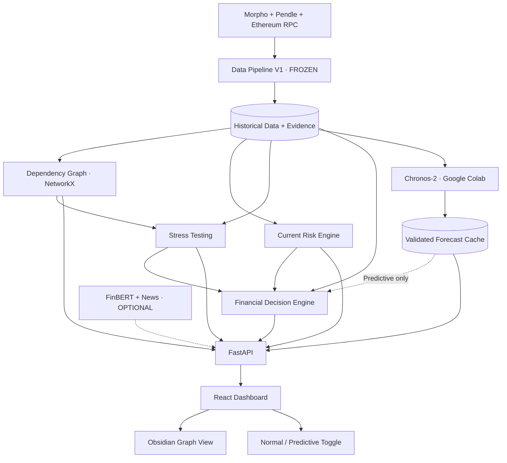

# DeFi Risk Radar — Architecture complète V1.1 (FIGÉE)

**Projet :** BSA Hackathon 2026 — Belem Capital DeFi Risk Challenge  
**Date de gel :** 10 octobre 2026  
**Statut :** `ARCHITECTURE_FROZEN` / périmètre MVP `P0_FROZEN`  
**Ce fichier est la référence d'intégration.** Les briefs 02–05 précisent le comportement *interne* des modules ; ils n'ajoutent aucun bloc ou lien obligatoire au schéma ci-dessous.

> **Produit :** *Discover dependencies → Quantify impact → Evaluate STAY or EXIT.*  
> Outil **read-only** : ni dépôt, ni swap, ni transaction, ni custody, ni signature utilisateur. Les recommandations sont **conditionnelles aux hypothèses affichées**, pas des ordres d'investissement.

## 0. Ce qui est immuable

- **Protocoles :** Morpho Blue (prêt et emprunt) + Pendle (marchés de PT, SY et dépendances du rendement), **Ethereum mainnet** (`chain_id=1`) pour le MVP.
- **Stratégie héro :** position d'emprunt USDC sur un **vrai marché Morpho** dont le collatéral est un **vrai PT Pendle**. Le **marché et les relations doivent être vérifiés** avant de prétendre qu'ils sont réels. La taille du fonds (collatéral 1–5 M$, par défaut 2 M$ ; dette par défaut 1,2 M$) est **simulée**, même si les paramètres du marché sont réels.
- **Topologie des moteurs V1.1 :** strictement celle du Mermaid suivant. Pas de nouvelle flèche ML → Stress, pas de dépendance FinBERT → Décision, pas de changement de source pour les moteurs.
- **Trois écrans :** Dependency Graph / Stress Simulator / STAY–EXIT Decision. Graph View immersive type **Obsidian**, avec inspector de preuves intégré.
- **Actions financières :** `STAY` et `EXIT` uniquement. **Pas de DELEVERAGE**.
- **P0 :** découverte des dépendances, estimation d'impacts, décision conditionnelle normale, preuve de données réelles, trois scénarios CTO : oracle hack, minting, cross-chain.
- **P1 :** Chronos-2 et mode Predictive ; **P2 hors MVP :** FinBERT et news. Le système doit être démontrable si les deux sont indisponibles.
- **Stockage MVP :** cache **JSON** versionné avec snapshots et preuves. Les formats publics **`data-contract-v1.0`** restent stables ; SQLite/Parquet de l'ancien brief ne sont pas requis.

## 1. Diagramme officiel V1.1 — à recopier sans modification



**Lecture :** `Historical Data + Evidence` désigne le **contenu logique** fourni par le Data Pipeline, **pas une obligation d'utiliser une base SQL**. En V1.1, il est persistant dans des fichiers JSON légers. Le module ML ne bloque jamais la route normale ; FinBERT fournit de l'information UI optionnelle, il ne change pas la décision financière du MVP.

## 2. Périmètre Belem et définition de « terminé »

Grille de notation fournie par le responsable projet d'après DoraHacks :

| Critère | Pondération | Notre preuve de valeur |
|---|---:|---|
| Dependency discovery | **30 %** | Graphe multi-hop authentique + evidence inspectable par arête |
| Impact estimation | **30 %** | Chocs, sous-graphe touché, exposition dédupliquée, risque de liquidation, pertes conditionnelles |
| STAY / EXIT decision | **25 %** | Comparaison quantitative **en mode Normal**, curseurs d'hypothèses, devis d'exit, seuil de renversement |
| Real-data demonstration | **15 %** | `chain_id=1`, IDs de marché, transactions / appels RPC et données officielles avec horodatage |

**Acceptation P0 = parcours complet observable et rejouable :**
1. Choisir une stratégie réellement vérifiée (ou afficher explicitement `NO_VERIFIED_LIVE_STRATEGY`).
2. Voir une position de fonds **SIMULATED** sur un marché **REAL** ; saisir dette et collatéral sans wallet.
3. Explorer au moins Morpho market → loan/collateral/oracle/IRM et PT → Pendle market → SY ; résoudre le rendement sous-jacent quand justifiable.
4. Cliquer une arête et voir contrat/source, méthode, bloc ou date, statut et incertitudes.
5. Simuler **oracle manipulation**, **unauthorized mint**, **cross-chain failure** ; distinguer scénario vérifié vs hypothétique / non applicable.
6. Chiffrer exposition unique, impact opérationnel, LTV et pertes **seulement si mécanisme + hypothèses** sont disponibles.
7. Obtenir **STAY ou EXIT** en mode Normal avec hypothèses financières explicites, ou une raison claire de non-calcul si devis impossible.
8. Modifier le montant du fonds et les probabilités et constater la mise à jour des résultats, à partir de données réelles ou d'un snapshot réel horodaté.
9. Passer sans erreur en mode Normal si aucun forecast n'est disponible.

## 3. Architecture par module et interfaces de responsabilité

| Bloc V1.1 | Rôle | Entrées | Sorties | Priorité |
|---|---|---|---|---|
| **Data Pipeline V1** | Collecter, normaliser et sourcer | Morpho, Pendle, Ethereum RPC (+ sources auxiliaires) | `MarketDTO`, `StrategyDTO`, `PositionDTO`, `Evidence`, séries, quotes cachées | P0 |
| **Historical Data + Evidence** | Fournir snapshot/replay; historique léger | Data Pipeline | JSON et index read-only pour moteurs | P0 |
| **Dependency Graph** | Découvrir les liens et les types de dépendance | DTO + relations + preuves | `GraphDTO`, impact reachability, chemins probants | P0 |
| **Current Risk Engine** | Caractériser le risque actuel, sans ML | métriques observées + preuves | factors / index si couverture suffisante + completeness/confidence | P0 minimal |
| **Stress Testing** | Tester un choc et quantifier les conséquences | snapshot + graph + position + hypothèses | `SimulationResult` par scénario | P0 |
| **Financial Decision** | Comparer STAY vs EXIT | data + current risk + stress outcomes + hypothèses + quote + forecast facultatif | `DecisionResult` + mode effectif + seuil break-even | P0 mode Normal |
| **Chronos-2 via Colab** | Prévoir des métriques futures | historiques normalisés | `ForecastBundle` évalué, daté, exporté en JSON | P1 |
| **Validated Forecast Cache** | Servir seulement des prévisions validées et fraîches | export Chronos | `ForecastBundle` ou indisponibilité | P1 |
| **FinBERT + News** | Classer le sentiment, rattacher événements documentés aux entités | RSS / GDELT / sources officielles | alerts annotées + status, **aucune proba d'incident** | P2 |
| **FastAPI** | APIs read-only et calculs à la demande | résultats des moteurs | `/api/v1/...` | P0 |
| **React Dashboard** | Parcours juge en 3 écrans | FastAPI | Graph View, Simulator, Decision, info evidence | P0 |

### Technologies

- **Backend :** Python 3.11+, FastAPI, Pydantic v2, httpx, web3.py, NetworkX, `decimal.Decimal`, NumPy pour calculs utiles.
- **Frontend :** React + TypeScript + Vite + Tailwind (shadcn/ui si équipe à l'aise), **react-force-graph-2d** pour l'effet Obsidian, Recharts pour données temporelles.
- **Stockage :** fichiers `JSON` / `JSONL` avec écriture atomique, métadonnées, date de collecte et manifest. Pas de PostgreSQL/SQLite/Parquet imposés pour le MVP.
- **ML P1 :** `amazon/chronos-2` dans **Google Colab** (calcul batch), puis JSON consommé par FastAPI. Aucun serveur permanent hébergé dans Colab.
- **News P2 :** `ProsusAI/finbert`, RSS officiels/GDELT, uniquement pour signaux contextuels.

## 4. Données de référence et langage commun

**Gel du contrat `data-contract-v1.0` :** conserver les IDs, enveloppe, règles d'unités et états de l'ancien brief Data V1 :

- `morpho:<chain_id>:<market_id>` ; `pendle:<chain_id>:<market_address_lowercase>` ; `asset:<chain_id>:<address_lowercase>`.
- Jointure interprotocole **par `chain_id` et adresse PT**, pas par symbole ou nom.
- Prix différenciés **obligatoirement** : prix de marché PT, prix **oracle Morpho** dans l'unité de dette, prix d'exécution exit pour une taille donnée. Ces prix ne sont pas interchangeables.
- LLTV et taux normalisés en ratios décimaux (`"0.915"` pour 91,5 %), montants comptables en chaînes décimales exactes (`Decimal`), dates ISO 8601 UTC.
- `null` + `missing_reason` pour donnée manquante ; `status`: `OK | PARTIAL | STALE | UNAVAILABLE`; sources, bloc/hash si appel on-chain, vérification par arête.
- La position **simulée** reste clairement distincte du marché réellement observé ; aucune transaction d'utilisateur n'est simulée comme ayant eu lieu on-chain.

### Stratégie héro et hypothèses

- Marché de référence choisi par matching réel Morpho collateral-token ↔ adresse PT Pendle. **Ne pas figer une adresse de marché non vérifiée**. Conserver un `reference_strategy_manifest.json` produit par vérification RPC avec `chain_id`, `market_id`, `pt_address`, `pendle_market_address`, `oracle`, `expiry`, `snapshot_block`, `verified_at`.
- Configuration initiale UI **fictive** : `$2,000,000` de collatéral, `$1,200,000` de dette ; réglage collatéral `$1m–$5m`. Appliquer le LLTV réel pour la position et vérifier que le marché est actif. **Vérifier aussi que la taille de la position est plausible** par rapport à l'offre/liquidité du marché et afficher `HYPOTHETICAL_SIZE` si elle ne l'est pas.
- Pour un prêt, le `LTV` du borrower = dette valorisée / collatéral valorisé **selon l'oracle du marché** ; `health_factor = LLTV / LTV` lorsque LTV > 0 ; équivalent `(collateral_oracle_value * LLTV)/debt`.
- Lending `SUPPLY` disponible pour analyse en lecture seule mais la démo centrale montre un borrowing ; ne pas inventer une liquidation côté prêteur.

## 5. Dependency Graph — règles gelées

**Orientation unique :** `dependent → dependency`. Exemple : `Position → Morpho market → collateral PT → Pendle PT market → SY → yield backing`, et branches `Morpho market → oracle / IRM / USDC loan token`.

**Classes minimales :** `POSITION`, `PROTOCOL`, `MARKET`, `ASSET`, `SY`, `ORACLE`, `PRICE_FEED`, `IRM`, `CHAIN`, `BRIDGE`, `CONTRACT` (seulement quand identifié), `GOVERNANCE` si preuve. Relations : `BORROWS_FROM`, `COLLATERALIZED_BY`, `PRICED_BY`, `USES_IRM`, `USES_SY`, `BACKED_BY`/`REDEEMS_THROUGH`, `RUNS_ON`, `BRIDGED_BY`, etc.

**Preuves :** chaque arête contient `relation_type`, `verification_status`, `evidence_ids`, `criticality`, `failure_mode`, `as_of`; les relations non vérifiées sont étiquetées et **exclues de la propagation confirmée**.

**Propagation :** partir du composant défaillant et remonter les **prédécesseurs** NetworkX ; visited set (éviter cycles), `position_id` set (éviter doubles comptes), fallback valide bloque la propagation appropriée. Séparer `confirmed_impacted` et `potential_impacted` ainsi que `operational` et `economic`.

**Trois métriques distinctes :** `potentially_exposed_capital_usd`, `gross_economic_exposure_usd` et `scenario_estimated_loss_usd` (ou `null`). Ne pas sommer les valeurs inscrites sur chaque lien, ne pas traiter une panne d'oracle comme une perte de 100 %.

## 6. Current Risk Engine — politique MVP

5 dimensions : **Liquidity, Security/Audits, Governance, Operational History, Systemic Dependencies**, 2 facteurs candidats par dimension (10 facteurs au total), pondération initiale égale. Un score ordinal `0–100` mesure **la sévérité des indicateurs observés**, pas une probabilité.

Afficher séparément `completeness` et `evidence_confidence` ; `null` pour facteur inconnu. Ne publier **le score agrégé** que si (choix interne) **complétude ≥50 % ET au moins 3 dimensions renseignées à ≥50 %**, sinon `risk_index=null, status=INSUFFICIENT_DATA`. Les métriques LTV/LLTV sont spécifiques à la position, distinctes du risque structurel du marché.

Important : factors de Morpho et Pendle doivent conserver leur signification. **Ne pas fabriquer une « utilization » Pendle** identique à celle d'un marché Morpho.

## 7. Stress Testing — scénarios prioritaires CTO

Chaque scénario doit déclarer `verified_applicability`, `scenario_scope` (`VERIFIED_TARGET`/`HYPOTHETICAL`/`NOT_APPLICABLE`), `assumptions`, `affected_nodes`, `affected_positions`, `confirmed_exposure`, `potential_exposure`, `operational_impact`, `liquidation_impact`, `scenario_loss_usd: null|decimal`, `warnings`, `evidence_ids`.

| Type P0 | Mécanisme | Variables UI minimales | Output justifiable |
|---|---|---|---|
| `ORACLE_MANIPULATION` | Prix oracle altéré (ou mode outage distinct) | choc oracle ± %, éventuel outage | LTV/health factor post-choc **dans l'unité correcte**, marge liquidation, opérations affectées |
| `UNAUTHORIZED_MINTING` | Token émis sans garanties suffisantes sur actif réellement dépendant ou hypothèse explicite | actif concerné + haircut de prix **séparé du montant minté** | chaînes de backing touchées, perte conditionnelle si haircut/quantité explicites |
| `CROSS_CHAIN_FAILURE` | Bridge / wrapping cross-chain / règlement bloqué, **uniquement si lien sourcé** | indisponibilité durée + haircut hypothétique facultatif | effet opérationnel, fonds dépendants potentiellement bloqués ; perte `null` sans haircut |

**Point important :** si notre PT n'a pas de dépendance bridge prouvée, le scénario est `NOT_APPLICABLE` sur le graphe réel, avec option de **fixture HYPOTHETICAL** à part. Ne dessiner **aucune** arête imaginaire dans le graphe real-data. Pour le mint, les pertes ne sont pas déduites mécaniquement du nombre de tokens mintés.

## 8. Financial Decision Engine — uniquement STAY / EXIT

### 8.1. Mode Normal (P0, jamais dépendant du ML)

Pour un même horizon `H`, même devise et même convention d'equity :

```
V_STAY(H) = equity_now + net_carry_over_H - scenario_expected_loss_over_H
V_EXIT    = equity_now - total_exit_cost_now
choose STAY if V_STAY > V_EXIT, otherwise EXIT (conditional on inputs)
```

- `equity_now` tient compte de collatéral et dette ; `net_carry` = rendement conditionnel du PT / coût dette / frais **seulement si calculable**.
- `scenario_expected_loss` = somme de `p_i(H) * conditional_loss_i(H)` **uniquement pour scénarios mutuellement exclusifs** ou si l'agrégation corrige les chevauchements ; sinon ne pas additionner aveuglément.
- Probabilités : métadonnée `HISTORICAL_ESTIMATE` si population/période/denominator valides ; `HISTORICAL_PROXY` pour analogue non calibré ; `USER_ASSUMPTION` pour curseur. **Aucune base de hacks ne fournit automatiquement la proba d'un oracle hack pour ce marché sur 7 jours.** Les fréquences historiques ne sont jamais « vérité ». Si insuffisant, curseurs d'hypothèses affichés comme *hypothèses illustratives*, pas de nombres présentés comme statistiques mesurées.
- Le coût de sortie est un **quote dépendant du montant** : simuler vente de la quantité PT récupérable, conversion sortie (USDC si possible), remboursement dette et frais, avec fraîcheur et faisabilité (`QUOTE_OK`, `STALE`, `UNAVAILABLE`, `NOT_FEASIBLE`). Un quote n'est ni un swap exécuté ni une garantie de liquidité.
- En absence de probas fiables, **un STAY/EXIT conditionnel est autorisé avec les hypothèses utilisateur** et le badge `ASSUMPTION_DRIVEN`. En absence de cotation/faisabilité de sortie exploitable, ne pas afficher de résultat monétaire trompeur ; publier `decision_status=INSUFFICIENT_DATA` et un seuil/break-even lorsque calculable.
- Afficher **seuil de bascule** : variation du prix oracle, perte ou probabilité maximale tolérable qui renverse STAY/EXIT. **Si les deux valeurs s'égalisent**, `verdict` peut rester `STAY`/`EXIT` avec `TIE` décrit, sans fausse précision.

### 8.2. Mode Predictive (P1)

Même moteur, argument `mode="predictive"`, horizon `1 | 3 | 7` jours. Lire **uniquement** le `Validated Forecast Cache` avec un bundle `status=VALIDATED` et `as_of` frais. Les prévisions PT/taux/liquidité ajustent seulement les **hypothèses futures directement modélisables** (carry, exit quote hypothétique futur, pertes conditionnelles si lien démontré). **Ne jamais recopier le PT spot prévu dans le prix oracle Morpho ni inventer des probabilités d'attaque.**

En cas d'absence/échec : `requested_mode=predictive`, `effective_mode=normal`, `fallback_reason=FORECAST_UNAVAILABLE|FORECAST_STALE|FORECAST_NOT_VALIDATED`. Le mode Normal fonctionne seul et rend la même décision qu'en son absence.

## 9. Frontend / Figma — 3 écrans, sans 4e page

| Écran | Sections visibles | Fonctions |
|---|---|---|
| **1. Dependency Graph** | Strategy selector, résumé montant/debt/LTV, trois métriques risque, canvas force-directed, inspector droite | Zoom/pan, focus, recherche, clic nœud ou arête → preuve, type de dépendance, unknown edge distinction |
| **2. Stress Simulator** | Sélecteur Oracle / Mint / Cross-chain, shock controls, KPIs avant/après, graphe impacté compact | Scénario réel/hypothétique, propagation, exposition ≠ perte, repositionnement des impacts |
| **3. STAY / EXIT Decision** | Toggle Normal/Predictive, sliders probabilités, horizon, quote sortie, deux colonnes de valeurs, seuil, explication | Verdict conditionnel, provenance, fallback Normal, montant 1–5 M$ |

**Design :** dark fintech institutionnel, composants réutilisables, fonds très sombres, labels de preuve, graph canvas interactif type Obsidian via `react-force-graph-2d`. Panneaux intégrés pour evidence/methodology/data status, aucun écran supplémentaire. L'ancien Figma V1 avec 10 frames est amendé par `02_ADDENDUM_UI_UX_FIGMA.md`.

## 10. Contrats FastAPI et JSON (conventions, sans fausses valeurs réelles)

**Préfixe :** `/api/v1`. Les routes Data V1 existantes demeurent ; les routes analytiques ci-dessous enrichissent cet espace, avec mêmes conventions d'enveloppe (`schema_version`, `status`, `as_of`, `data`, `provenance`, `missing_fields`, `warnings`).

| Endpoint | Méthode | Module propriétaire |
|---|---|---|
| `/api/v1/strategies` ; `/{id}` | GET | Data |
| `/api/v1/markets` ; `/{id}` | GET | Data |
| `/api/v1/positions/{id}` | GET | Data / read-only |
| `/api/v1/evidence/{id}` | GET | Data |
| `/api/v1/series` | GET | Data |
| `/api/v1/graph/{strategy_id}` | GET | Graph |
| `/api/v1/risk/{strategy_id}` | GET | Current Risk |
| `/api/v1/scenarios` | GET | Stress |
| `/api/v1/simulations` | POST | Stress |
| `/api/v1/incident-frequencies` | GET | Assumptions within Decision |
| `/api/v1/exit-quotes` | POST | Pendle/Data adapter |
| `/api/v1/decisions` | POST | Decision |
| `/api/v1/forecasts/{strategy_id}` | GET | Forecast Cache · P1 |
| `/api/v1/news/{strategy_id}` | GET | News · P2 |

**Analytical APIs respond with the same envelope**; their payloads below are **proposed implementable P0 contracts** (new analytics fields, not a change to Data DTO v1).

### 10.1 `SimulationRequest` (synthetic example)

```json
{
  "strategy_id": "strat:demo-pt-morpho-v1",
  "position_id": "sim:fund-001",
  "scenario_type": "ORACLE_MANIPULATION",
  "scope": "VERIFIED_TARGET",
  "target_node_id": "oracle:1:0x<oracle-address>",
  "parameters": {"oracle_price_change_ratio": "-0.20"},
  "horizon_days": 7
}
```

### 10.2 `DecisionRequest` (synthetic example)

```json
{
  "strategy_id": "strat:demo-pt-morpho-v1",
  "position_id": "sim:fund-001",
  "mode": "normal",
  "horizon_days": 7,
  "probability_assumptions": [
    {
      "scenario_type": "ORACLE_MANIPULATION",
      "probability_over_horizon": "0.02",
      "basis": "USER_ASSUMPTION",
      "overlap_group": "scenario-family-A"
    }
  ]
}
```

`0.02` est une **hypothèse illustrative saisie par un utilisateur**, pas une statistique établie. Le calcul normal doit être fonctionnel avec les autres champs issus du snapshot, de la position et de la cotation de sortie.

### 10.3 `DecisionResult` (shape)

```json
{
  "requested_mode": "predictive",
  "effective_mode": "normal",
  "fallback_reason": "FORECAST_UNAVAILABLE",
  "decision_status": "INSUFFICIENT_DATA",
  "verdict": null,
  "horizon_days": 7,
  "stay_value_usd": null,
  "exit_value_usd": null,
  "expected_loss_usd": null,
  "exit_cost_usd": null,
  "break_even_probability": null,
  "assumptions": [],
  "warnings": [],
  "as_of": null
}
```

**Important :** les `null` sont des **placeholders de schéma**, pas la preuve d'un calcul. Une vraie décision `CONDITIONAL` ne peut être retournée que lorsque les valeurs STAY/EXIT nécessaires sont non nulles. Sinon `decision_status="INSUFFICIENT_DATA"`, `verdict=null`.

## 11. Tests non négociables

- Contrats DTO réutilisés, aucune adresse qui change de chaîne sans preuve.
- Même prix oracle utilisé dans le LTV (et dans le choc oracle) ; PT spot distinct du quote de sortie.
- Graph `dependent → dependency`, reverse-BFS, cycles et chemins multiples sans double compte.
- Oracle outage peut bloquer des actions **sans** perte supposée.
- Mint attack ne déduit pas le haircut du seul mint amount.
- Cross-chain sans lien vérifié = hypothèse clairement labellisée, jamais présenté comme réel.
- Scénario sans haircut/récupération = `estimated_loss_usd=null`.
- Normal = fonctionne si les dossiers ML et News sont absents.
- Predictive indisponible = fallback effectif Normal et verdict identique à la décision normale recalculée avec les mêmes données.
- 1 M$ vs 5 M$ : quote en quantité de PT ajustée à la taille ; ne pas appliquer un simple spread constant sans source.
- Cache étiqueté `snapshot_as_of` (données vraies et stale possibles) ; pas de `LIVE` faux.
- Ne pas mélanger les branches probabilité de hack et prévision de prix PT.

## 12. Livraisons équipe / ownership (5 développeurs)

| Dev | Propriétaire | Done P0 |
|---|---|---|
| 1 — Frontend | React / 3 écrans | navigation, graph canvas, inspecteur preuves, sliders, decision toggle et affichage des états |
| 2 — Graph | NetworkX | graphe réel, arêtes sourcées, reverse reachability + exposure union |
| 3 — Morpho/Data | sources/normalisation | marché vérifié, oracle, position fictive, DTO V1, cache JSON et health |
| 4 — Pendle/Exit | PT/SY, quote d'exit | vraie jointure PT et devis pour différentes tailles ; ML seulement après P0 |
| 5 — Risk/Stress/Decision | analytics | facteurs observables, 3 scénarios, pertes conditionnelles, décision Normale |

Le développeur du brief ML/News (`05_BRIEF_DEV_ML_FORECAST_NEWS.md`) peut être un contributeur désigné / un rôle P1-P2 ; **il ne constitue pas un sixième poste P0** et ne doit pas bloquer les cinq responsables du MVP.

## 13. Références officielles à garder dans le repo

- Morpho API : https://docs.morpho.org/developers/api/morpho/
- Morpho Blue on-chain : https://docs.morpho.org/developers/contracts/blue/
- Pendle Hosted SDK / Convert API : https://docs.pendle.finance/pendle-v2-dev/Backend/HostedSdk
- Pendle RouterStatic : https://docs.pendle.finance/pendle-v2-dev/Contracts/RouterStatic/ApiReference/SwapFunctions
- Chronos-2 : https://huggingface.co/amazon/chronos-2
- Chronos Python officiel : https://github.com/amazon-science/chronos-forecasting
- FinBERT : https://huggingface.co/ProsusAI/finbert
- Google Colab FAQ : https://research.google.com/colaboratory/faq.html

## 14. Fichiers livrés en parallèle

- `02_ADDENDUM_UI_UX_FIGMA.md` — remplace **uniquement** le sitemap, le nombre d'écrans, le Decision Panel et la taille de la position de l'ancien brief Figma.
- `03_ADDENDUM_DATA_PIPELINE_V1.md` — **delta** stockage JSON, incidents historiques et devis Pendle ; conserve `data-contract-v1.0`.
- `04_BRIEF_DEV_CORE_ENGINES.md` — spécification de développement Graph, Current Risk, Stress & Decision.
- `05_BRIEF_DEV_ML_FORECAST_NEWS.md` — Chronos-2, forecast cache, Colab, validation et FinBERT facultatif.
