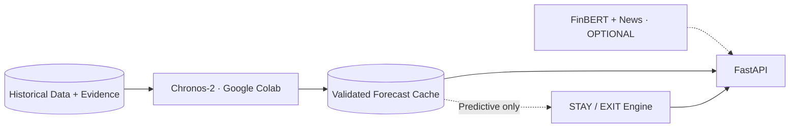

# DeFi Risk Radar — Brief développeur ML / Validated Forecast Cache / News

**Destinataire :** développeur ML (ou développeur Pendle une fois ses livrables P0 terminés), contributeur NLP optionnel  
**Version :** `ml-news-v1.1` · 10 octobre 2026  
**Priorité :** **P1 Chronos-2 + Forecast Cache** ; **P2 FinBERT / News**, strictement *hors MVP*.  
**Contrainte centrale :** ne **jamais** bloquer `/api/v1/decisions` en **mode Normal**. Conserver **exactement** l'architecture V1.1, en particulier `Historical Data + Evidence → Chronos-2 (Colab) → Validated Forecast Cache → Decision (Predictive only)` ; `FinBERT + News` → FastAPI/UI **optionnel**, pas Decision P0.

## 0. Mission produit

**Objectif P1 :** construire un signal prédictif réel, mesurable et justifiable à partir de données historiques Morpho/Pendle **sans le vendre comme une prévision de piratage**.

**User story :** « En tant qu'investisseur, j'active le mode Predictive et je vois comment des prix PT ou taux d'emprunt futurs plausibles influenceraient mes résultats STAY/EXIT sur J+1, J+3 ou J+7. Si les données sont insuffisantes, le mode Normal fonctionne sans différence. »

**Objectif P2 (News) :** « Je clique sur un nœud du graphe et, si des informations externes réellement pertinentes ont été vérifiées, je vois les annonces susceptibles de mériter une revue humaine. » **FinBERT ne prédit pas les hacks** et ne doit fournir aucune « probabilité de faillite ».

## 1. Frontières immuables de l'architecture



Ce diagramme est un **zoom**, pas un remplacement du diagramme global V1.1. **Le Data Pipeline V1 reste gelé** : il fournit `TimeSeriesPoint` ou un export dérivé ; l'historique stocké pour le modèle est hors SQL obligatoire du MVP.

**Colab sert au notebook / entraînement / inférence batch.** Ne pas exposer une URL ngrok/Flask/FastAPI permanentes depuis Colab : ressources temporaires et restrictions d'hébergement web. Le backend de l'application **lit un fichier JSON exporté** ou, après hackathon, un vrai endpoint d'inférence déployé séparément. Pour P1, privilégier le **fichier de résultat**.

## 2. Cibles ML et priorités définitives

| Priorité | Target (`metric`) | Raison | Source primaire potentielle | Si non disponible |
| --- | --- | --- | --- | --- |
| **P1-A** | `PT_MARKET_PRICE_USD` | Prix d'actif sur Pendle, visuel simple, suivi d'horizon | Historique Pendle | `FORECAST_UNAVAILABLE` |
| P1-B | `MORPHO_BORROW_APY_RATIO` | Coût future de dette | Historique Morpho | omettre |
| P1-B | `PENDLE_IMPLIED_APY_RATIO` | Rendement implicite PT | Historique Pendle | omettre |
| P1-B | `MORPHO_UTILIZATION_RATIO` | Tension de prêt | Morpho state history | omettre |
| P1-B | `PENDLE_MARKET_LIQUIDITY_USD` (si vraie série) | Pression sur profondeur de marché | Pendle historiques, **vérifier** unité | omettre |

**Horizon** : **J+1**, **J+3**, **J+7**. Commencer avec pas **journalier** et 7 jours de prévisions, puis lire les points aux jours 1/3/7. Si le modèle/les sources sont horaires, aligner proprement à 24/72/168 steps, **pas 1/3/7 steps horaires**.

**La valeur « 5 targets » est un maximum, pas une promesse** : on ajoute un target uniquement si des observations suffisantes et un benchmark convaincant existent. Un modèle préentraîné ne crée pas une série historique qui n'existe pas. Les PT expirent : ne pas faire d'extrapolation naïve au-delà de l'échéance sans logique métier définie.

## 3. Sources et préparation des historiques

Consommer le `TimeSeriesPoint` existant :

```json
{
  "entity_id": "pendle:1:0x<market-address>",
  "metric": "PT_MARKET_PRICE_USD",
  "ts_utc": "2026-10-01T00:00:00Z",
  "value_decimal": "0.945",
  "unit": "USD_PER_PT",
  "sampling_interval": "1d",
  "source_id": "PENDLE_CORE_API",
  "quality_flags": [],
  "is_interpolated": false
}
```

**Règles :**

1. `chain_id=1`, adresse du market PT **exacte** ; ne pas confondre marchés PT d'échéances différentes.
2. Horodatage **UTC** ; conserver le `source_as_of` et le `retrieved_at` de la collecte. Un backtest ne peut utiliser les observations postérieures à la date de prévision.
3. `PT_MARKET_PRICE_USD` **seulement** = prix spot indicatif Pendle ; ne pas le substituer à `MORPHO_ORACLE_PRICE_LOAN_PER_COLLATERAL` ou `EXIT_EXECUTION_PRICE`.
4. Unité et ratio de taux explicites (`0.04` = 4 % APY) ; traiter séparément des prix en dollars.
5. Régulariser les timestamp selon fréquence retenue ; **ne pas interpoler une grande période manquante** sans drapeau et test de sensibilité. Séries courtes/irrégulières ⇒ unavailable.
6. `PT expiry` et `days_to_maturity` : au minimum enregistrer comme metadata ; ne pas utiliser les valeurs futures de covariables qui sont elles-mêmes inconnues. Le temps jusqu'à échéance est connu, donc utilisable.
7. Vérifier pagination, trous, quota API et durée de collecte avant de sélectionner le marché de démonstration.
8. Chaque forecast hérite du `strategy_id`, `chain_id`, du PT `market_id` et du `latest_observation_at`.

### Garde-fous de taille des données

**Seuil technique interne proposé** : au moins **45 observations quotidiennes réelles** avant une prévision affichée, **avec assez de points supplémentaires pour des fenêtres de backtest**, et suffisamment de variabilité pour valider. Ce seuil est un **minimum de produit arbitré pour le hackathon, pas un critère scientifique universel** ; si chronos/benchmark indiquent insuffisant, relever l'exigence ou ne rien afficher. Faire au moins plusieurs fenêtres chronologiques indépendantes ; ne pas annoncer une MAE sur un seul point.

## 4. Chronos-2 — modèle candidat P1

**Modèle officiel :** <https://huggingface.co/amazon/chronos-2>
**Repo :** <https://github.com/amazon-science/chronos-forecasting>
**Lib :** `chronos-forecasting>=2.0` ; Chronos-2 ~120 M paramètres, forecasting univarié/multivarié, quantiles.

### Notebook Colab demandé

```text
notebooks/chronos2_pendle_benchmark.ipynb
    1. Configure data export/snapshot path
    2. Verify schema/UTC/unity/expiry, quality report
    3. Select PT market & target and plot raw history
    4. Chronological backtest vs naïve persistence
    5. Load pretrained Chronos-2 with official package
    6. Predict daily quantiles q10/q50/q90 over 1, 3, 7 days
    7. Record out-of-sample metrics and limitations
    8. Export validated JSON (if acceptance gates pass)
    9. Export explicit UNAVAILABLE report otherwise
```

### Exemple minimal de chargement (API documentée ; adapter à vos vrais CSV/JSON)

```python
# Notebook / Colab only (not FastAPI runtime)
# !pip install -U 'chronos-forecasting>=2.0' 'pandas[pyarrow]' torch

from chronos import Chronos2Pipeline

model = Chronos2Pipeline.from_pretrained(
    "amazon/chronos-2",
    device_map="cuda",  # Utiliser "cpu" si GPU indisponible
)

# context_df doit avoir: item_id, timestamp, target (daily UTC, no unhandled gaps)
# prediction_length=7 = 7 jours uniquement si une observation par jour.
forecast_df = model.predict_df(
    context_df,
    prediction_length=7,
    quantile_levels=[0.1, 0.5, 0.9],
    id_column="item_id",
    timestamp_column="timestamp",
    target="target",
)
```

Ce bloc présume que `context_df` a été créé et nettoyé en amont ; il n'est **pas** un downloader. `predict_df` peut renvoyer `predictions`, `0.1`, `0.5`, `0.9` selon version ; inspecter le résultat avant de sérialiser. **Ne pas prétendre avoir exécuté le modèle tant qu'un vrai Colab n'a pas produit ses sorties.**

## 5. Validation quantitative : aucune prédiction non évaluée

**Baseline P0 de benchmark :** naïve/persistence `price[J+h] = latest_price` et moyenne glissante simple, pour comparaison. Le benchmark est un livrable P1 : même pas besoin d'un benchmark complet AutoARIMA si le temps manque ; il vaut mieux 1 baseline **correcte** que 3 baselines mal entraînées.

**Walk-forward backtesting :** choisir plusieurs origines `t` strictement antérieures à la partie test ; prédire la fenêtre suivante sans réutiliser les points futurs ; calculer MAE, RMSE, directional accuracy secondaire, quantile pinball loss et couverture q10–q90 si quantiles disponibles.

**Conditions pour afficher `status=VALIDATED` dans le produit** :

- Série et dates de bonne qualité ; snapshots/références disponibles ; au moins quelques fenêtres out-of-sample utilisables.
- Résultats du modèle et d'une baseline sur exactement les **mêmes** fenêtres.
- Gain mesurable ou performance jugée adéquate et **publiée avec réserves** ; si Chronos ne bat pas naïve, **ne pas prétendre à un gain prédictif** et préférer `FORECAST_NOT_VALIDATED` ou afficher la baseline comme telle.
- Quantiles ordonnés `q10 <= q50 <= q90`, nombres finis, cohérence des unités, aucune étiquette « confidence 90 % de ne pas perdre ».
- Maturité : le forecast ne peut pas dépasser la date où la cible conserve le même sens économique, sauf modèle spécialisé et déclaré.
- `training_cutoff_at <= generated_at`, `as_of` source explicite et cache frais selon une politique documentée.

**Statut** : `VALIDATED`, `INSUFFICIENT_HISTORY`, `NOT_BETTER_THAN_BASELINE`, `MODEL_ERROR`, `STALE`, `NOT_RUN`. Une prévision enregistrée peut être exposée à l'UI en `RESEARCH_ONLY` mais **pas** branchée à Decision si pas validée.

## 6. `ForecastBundle` — sortie JSON contractuelle

Emplacement cible : `backend/cache/forecasts/{strategy_id-safe}/{target}/forecast.json` ; noms de fichier sûrs (ne pas utiliser raw `/`, `:` sans normalisation). Écriture atomique ; le backend FastAPI **charge et valide le JSON**, sans importer `torch` ni `chronos`.

### Exemple de contrat (valeurs imaginaires, PAS sortie réelle)

```json
{
  "schema_version": "forecast-contract-v1.0",
  "forecast_id": "forecast:demo:pt-usd",
  "strategy_id": "strat:demo-pt-morpho-v1",
  "chain_id": 1,
  "entity_id": "pendle:1:0x<market-address>",
  "target_metric": "PT_MARKET_PRICE_USD",
  "unit": "USD_PER_PT",
  "frequency": "1d",
  "horizons_days": [1, 3, 7],
  "model_id": "amazon/chronos-2",
  "model_version": "pinned-commit-or-package-version",
  "trained_on_defi": false,
  "zero_shot": true,
  "status": "NOT_RUN",
  "generated_at": null,
  "latest_observation_at": null,
  "training_cutoff_at": null,
  "source_snapshot_ref": null,
  "backtest": {
    "protocol": "walk-forward",
    "n_evaluations": 0,
    "mae_model": null,
    "mae_naive": null,
    "rmse_model": null,
    "coverage_q10_q90": null,
    "validation_status": "NOT_RUN"
  },
  "points": [
    {"horizon_days": 1, "q10": null, "q50": null, "q90": null},
    {"horizon_days": 3, "q10": null, "q50": null, "q90": null},
    {"horizon_days": 7, "q10": null, "q50": null, "q90": null}
  ],
  "limitations": ["Example contract only; no model has been executed"]
}
```

**Important :** un bundle de ce type avec `status=NOT_RUN` doit déclencher le fallback Normal. `VALIDATED` ne s'obtient pas en changeant simplement la valeur du champ — le `ForecastCache` effectue ses propres vérifications sur les dates, données et métadonnées.

## 7. Forecast Cache — intégration FastAPI P1

- Route `GET /api/v1/forecasts/{strategy_id}?target=PT_MARKET_PRICE_USD` → forecast ou réponse stable `status=UNAVAILABLE` et `reason` ; jamais un faux 200 `VALIDATED`.
- Route Decision P0 `POST /api/v1/decisions` avec `mode=normal|predictive`. En `normal`, **zéro** tentative de chargement du modèle ; en `predictive`, lire forecast cache **seulement**.
- Si forecast pas validé, expiré, de marché/chain incorrect, hors maturité ou de timeframe non disponible : `requested_mode=predictive`, `effective_mode=normal`, `fallback_reason` détaillé. Refaire l'analyse Normal sans modifier ses résultats.
- Vérifier `model_id`, `source_snapshot_ref`, `horizon_days`, `target`, `trained_on_defi=false`, `validation_status`, `as_of`, `q10 <= q50 <= q90`, valeurs positives pour prix.
- TTL initial recommandé pour une prévision basée sur des observations quotidiennes : **24h à partir du dernier point**, ajustable selon fréquence ; pas un SLA.
- Si ForecastBundle est valide : fournir `forecast_summary`, `forecast_quality`, `forecast_assumptions` ; le Decision Engine peut appliquer l'effet aux **cashflows économiques** explicitement modélisés, **jamais** réécrire le prix oracle Morpho, **jamais** remplacer les probabilités historiques ou utilisateur.

### Tests d'intégration P1

1. Pas de dossier `cache/forecasts` → backend démarre, `Normal` fonctionne, `Predictive` tombe en Normal.
2. JSON invalide / champs absents → fallback, log erreur, pas 500 fatal.
3. Cache plus vieux que TTL → `STALE` et fallback.
4. Cache sur `chain_id=8453` pour une stratégie sur `chain_id=1` → rejet.
5. Bundle status `NOT_BETTER_THAN_BASELINE` → display recherche possible mais pas moteur Decision.
6. PT spot prévu -10% → **pas** injection dans `morpho_oracle_price`.
7. Mode Normal identique avec et sans bundle enregistré.
8. Trois horizons J+1/J+3/J+7 testés (avec pas journalier correct).

## 8. FinBERT + News (P2 seulement — NE PAS BLOQUER P0/P1)

### Finalité

Ajouter **un panneau contextuel facultatif** dans le Graph Inspector / Decision sous la forme « External event signals » ; ne pas ajouter une quatrième page Figma. **FinBERT** classe le sentiment du texte en positif/négatif/neutre : ce n'est ni la classification de l'attaque, ni la preuve que le protocole mentionné est effectivement touché.

**Sources :** flux RSS **officiels** Morpho, Pendle et protocoles/émetteurs réellement présents dans le graphe ; GDELT seulement pour chercher des publications à **vérifier**. Ne pas alimenter les scores de risques et probabilités P0 avec des news non confirmées.

### Pipeline optionnel

```text
News RSS / GDELT
  → deduplicate URL/title/publisher/date
  → validate source + published_at + first_seen_at
  → identify entity (contract/issuer/protocol) with evidence
  → classify event type with conservative rules or curated mapping
  → FinBERT sentiment label (positive/negative/neutral)
  → optional Graph node annotation / React Evidence Drawer
```

**Exemple important :** une brève « stablecoin issuer pauses redemption » peut être **négative**, mais FinBERT n'établit pas que l'actif de notre PT dépend effectivement de cet émetteur. Faire l'entity-linking avec une relation vérifiée ; sinon `UNMATCHED`.

### FinBERT technique

- Modèle : <https://huggingface.co/ProsusAI/finbert>.
- Package Transformers/PyTorch ; inférence batch / petit cache JSON, pas de boucle d'actualités temps réel obligatoire.
- Ne jamais convertir un score de sentiment `0.9` en « 90 % risk » ou p(oracle hack). Les scores de modèle sont des scores de classification de texte, pas du risque financier.

```python
# Optional P2 only
from transformers import pipeline
sentiment_model = pipeline("text-classification", model="ProsusAI/finbert")
result = sentiment_model("Issuer announces temporary withdrawal restrictions.")
# Sentiment ONLY. Must verify issuer relevance and event evidence separately.
```

### `NewsSignalDTO` minimal

```json
{
  "signal_id": "news:demo:001",
  "headline": "Illustrative issuer announcement",
  "publisher": "Example Source",
  "url": null,
  "published_at": null,
  "first_seen_at": null,
  "linked_node_ids": [],
  "entity_match_status": "UNMATCHED",
  "event_type": "UNVERIFIED",
  "sentiment": {"label": "negative", "model_id": "ProsusAI/finbert", "raw_score": null},
  "risk_probability": null,
  "warnings": ["Illustrative object; not a real news item"]
}
```

FastAPI route P2 `GET /api/v1/news/{strategy_id}` répond `UNAVAILABLE`/liste vide si la fonctionnalité n'est pas activée. **Ne pas lier News → Financial Decision Engine** dans le MVP. La topologie officielle V1.1 prévoit news uniquement vers FastAPI et l'UI.

## 9. Ownership, ordre de travail et jalons

| Priorité | Étape | Livrable | Condition pour avancer |
| --- | --- | --- | --- |
| P1 | 1. Inventaire historiques | vrai PT, son histoire, qualité, expiry | >= historique raisonnable et unités correctes |
| P1 | 2. Baseline | notebook de persistence / backtest | métriques chronologiques reproductibles |
| P1 | 3. Chronos-2 | quantiles forecasts, comparaison baseline | modèle réellement exécuté, pas un mock |
| P1 | 4. Export | ForecastBundle JSON versionné | `status` justifié et dates cohérentes |
| P1 | 5. Intégration | ForecastCache FastAPI + UI toggle | Normal unaffected, fallback testé |
| P1 | 6. Bonus targets | borrow APY/implied APY/liquidity | chaque target validé séparément |
| P2 | 7. News ingestion | source→entity mapping | sources pertinentes prouvées |
| P2 | 8. FinBERT | signal de sentiment | bon mapping et aucune pseudo-proba |

### Conditions de sortie

**P1 done :** le dashboard montre un forecast **reproductible et évalué**, avec sa période, sa baseline, ses quantiles, son modèle et ses limites ; décision conditionnelle Predictive possible **seulement** si l'effet financier est défendable ; sinon le forecast reste informatif et l'engine passe en Normal.

**P2 done :** un signal d'actualité possède un vrai article, une entité correctement rattachée au graphe, un sentiment FinBERT identifié et **aucune influence cachée sur le verdict financier**.

**P0 unaffected :** si le développeur ML ou News n'a pas livré une seule ligne de code, **Graph → Stress → STAY/EXIT Normal sur données réelles fonctionne toujours**.

## 10. Sources officielles et politiques

- <https://huggingface.co/amazon/chronos-2>
- <https://github.com/amazon-science/chronos-forecasting>
- <https://huggingface.co/ProsusAI/finbert>
- <https://research.google.com/colaboratory/faq.html> (Colab ≠ hosting permanent)
- <https://docs.pendle.finance/pendle-v2-dev/Backend/ApiOverview>
- <https://docs.morpho.org/developers/api/morpho/>
