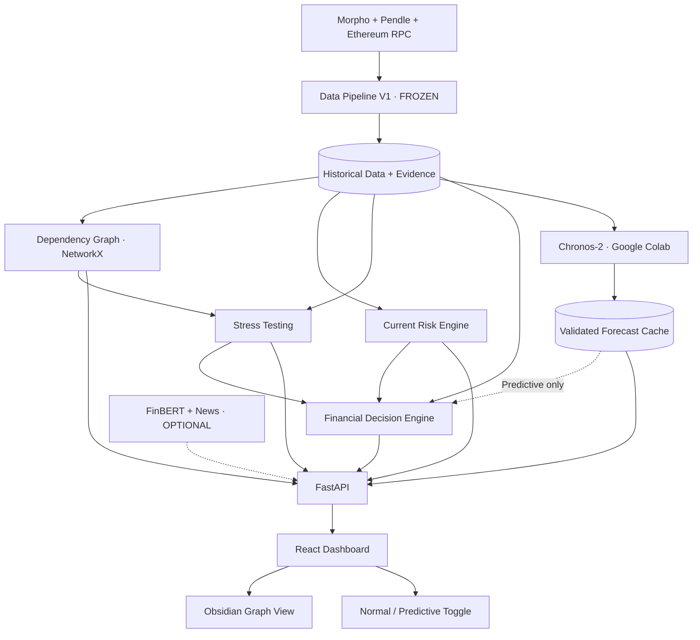

# CODEX CONTEXT — BSA Hackathon 2026 · DeFi Risk Radar

> **Document de cadrage et d'implémentation à transmettre à Codex**  
> Projet : **DeFi Risk Radar — An X-Ray for DeFi Portfolios**  
> Challenge sélectionné : **Belem Capital — DeFi Risk Dependency Challenge**  
> Référence obligatoire : **`01_ARCHITECTURE_COMPLETE_V1_1.md`**, gelée le **10 octobre 2026**  
> Version de ce document : **Codex kickoff / contexte global** (ne modifie ni la V1.1 ni `data-contract-v1.0`).

## 0. Mission de Codex et ordre de priorité

**Tu es Codex, assistant de développement du projet DeFi Risk Radar.** Tu dois comprendre le challenge et la totalité du produit, puis travailler sur le **lot explicitement demandé dans la conversation ou les issues**. Le lot ML du contributeur principal s'appelle **Marillou**. Il consiste à construire la brique de *forecasting* P1, et **non** à programmer le moteur de décision financière STAY/EXIT.

Règles d'autorité :

1. **Source d'architecture unique** : `01_ARCHITECTURE_COMPLETE_V1_1.md`, statut `ARCHITECTURE_FROZEN` / `P0_FROZEN`.
2. **Contrats data existants** : `data-contract-v1.0` et définitions du Data V1 ; ne pas casser IDs, DTO, enveloppes et unités.
3. **Documents complémentaires**, s'ils sont réellement présents dans le dépôt : `02_ADDENDUM_UI_UX_FIGMA.md`, `03_ADDENDUM_DATA_PIPELINE_V1.md`, `04_BRIEF_DEV_CORE_ENGINES.md`, `05_BRIEF_DEV_ML_FORECAST_NEWS.md`. Ils détaillent leurs modules **sans modifier la topologie**.
4. **Ce document** explique le pourquoi et indique une séquence de travail. **En cas de divergence, la V1.1 prévaut**. Ne considère pas comme existant un fichier, endpoint, marché ou schéma que tu n'as pas trouvé/vérifié.

Avant de coder : **inspecte réellement le repository** (`ls`, README, arborescence, dépendances, tests, fichiers de contrats), identifie ce qui est déjà implémenté, et ne duplique pas une brique confiée à un autre développeur. Si une information critique manque, conserve un état explicite *unavailable* au lieu d'inventer un résultat.

---

## 1. Contexte : le hackathon et le track Belem Capital

### 1.1 L'événement

Le hackathon est organisé par la **Blockchain Student Association de l'EPFL (BSA)**, avec **Belem Capital** et **Swissquote** comme sponsors. L'événement se déroule à l'EPFL, dans le bâtiment BC. Il propose notamment un track autour du **risque DeFi** et un autre autour des **wallets self-custody**. Nous avons choisi **le track de Belem Capital sur les dépendances de risque DeFi**, et non celui des wallets.

- Page organisateur : https://luma.com/d5gqew38
- Lien vers les tracks indiqué par l'organisateur : https://dorahacks.io/hackathon/bsa-the-hackathon/tracks
- Le hackathon est court : privilégier une **démo end-to-end crédible** plutôt qu'une plateforme tentaculaire.

**Précision sur les scores ci-dessous :** la répartition vient de la grille consignée par le responsable projet dans l'architecture V1.1, d'après DoraHacks ; nous n'avons pas ici une reproduction indépendante du texte complet du règlement du track. Ne la réécris pas comme une citation officielle mot pour mot.

### 1.2 Le problème à résoudre

Dans la DeFi (*Decentralized Finance*), les stratégies de rendement sont **composables** : une position en apparence simple peut dépendre d'une succession de protocoles, tokens, marchés, contrats, oracles, liquidités et infrastructures.

Un investisseur peut par exemple emprunter des **USDC sur Morpho Blue**, en déposant comme collatéral un **Principal Token (PT) de Pendle**. Derrière ce PT se trouvent un marché Pendle, un **SY (Standardized Yield)**, et éventuellement d'autres actifs ou systèmes de rendement. Le marché Morpho dépend aussi d'un **oracle** pour valoriser le collatéral et d'un mécanisme de taux d'intérêt (IRM).

Le vrai risque n'est donc pas seulement « est-ce que Morpho fonctionne ? » ou « quel est le taux d'intérêt ? », mais aussi :

- **De quoi ma position dépend-elle réellement ?**
- **Quelles dépendances sont vérifiables, lesquelles restent inconnues ?**
- **Que se passe-t-il si un composant est défaillant, manipulé ou bloqué ?**
- **Quelle partie de mon exposition est impactée, et quelle perte peut-on estimer sans spéculer ?**
- **Dans les hypothèses et aux prix de sortie disponibles, vaut-il mieux STAY ou EXIT ?**

### 1.3 Attentes du challenge consignées dans la V1.1

| Dimension | Pondération issue de la V1.1 | Preuve attendue dans notre démonstration |
|---|---:|---|
| **Dependency discovery** | 30 % | Graphe multi-hop réel, relations vérifiées, preuves inspectables |
| **Impact estimation** | 30 % | Propagation contrôlée des scénarios, capital exposé dédupliqué, LTV/liquidation, pertes justifiées |
| **STAY / EXIT decision** | 25 % | Comparaison financière conditionnelle en **mode Normal**, coût de sortie et seuil de bascule |
| **Real-data demonstration** | 15 % | Contrats, IDs, prix et paramètres de marché réels, sourcés et datés |

**Notre réponse au challenge :** un **radar de risque explicable**, pas un robot de trading, pas une application de wallet, pas un simple classement de protocoles, et pas une boîte noire qui affiche arbitrairement `EXIT`.

---

## 2. Notions DeFi minimales pour ne pas coder de contresens

| Concept | Signification dans notre projet |
|---|---|
| **USDC** | Token utilisé pour la dette du scénario principal ; vérifier sa véritable adresse sur Ethereum mainnet. |
| **Morpho Blue** | Protocole de marchés isolés de prêt/emprunt. Un marché précise notamment le loan token, le collateral token, l'oracle, l'IRM et le LLTV. |
| **Borrow position** | Position qui dépose un collatéral et emprunte des USDC. Elle peut subir une liquidation si sa santé devient insuffisante. |
| **Pendle** | Protocole de marchés de tokens liés au rendement d'un actif sous-jacent. |
| **PT (Principal Token)** | Token de Pendle lié à une échéance ; **ne pas** assimiler mécaniquement son prix de marché au prix utilisé par l'oracle Morpho. |
| **SY (Standardized Yield)** | Interface d'actif de rendement utilisée par les marchés Pendle ; le backing exact doit être résolu à partir de preuves. |
| **Oracle** | Composant utilisé pour valoriser le collatéral de la position Morpho ; une erreur de prix peut modifier LTV et possibilité de liquidation. |
| **IRM** | *Interest Rate Model* du marché Morpho, qui détermine le coût de l'emprunt. |
| **LLTV** | *Liquidation Loan-To-Value*, seuil de ratio dette / valeur du collatéral du marché. |
| **LTV** | `debt_value / collateral_oracle_value`, en unités compatibles ; dépend du prix oracle Morpho. |
| **Health factor** | `LLTV / LTV` si `LTV > 0`. Une dégradation vers/sous 1 signale un risque de liquidation selon le mécanisme applicable. |
| **Exit quote** | Devis de liquidation de la position **calculé pour une taille donnée** ; ce n'est ni le prix spot PT ni une transaction exécutée. |
| **Evidence** | Référence datée à un RPC, contrat, API officielle, bloc/hash, documentation ou donnée permettant de justifier une relation/mesure. |

Exemple **purement pédagogique, pas une donnée on-chain** : si une position a 2 M$ de **collatéral valorisé par l'oracle** et 1,2 M$ de dette dans la même unité, `LTV = 0,60` (60 %). Le health factor exige encore le **LLTV réel du marché**. Cet exemple ne vérifie ni la valeur du PT ni la faisabilité d'un exit.

---

## 3. Produit : DeFi Risk Radar

**Pitch produit** : *Discover dependencies → Quantify impact → Evaluate STAY or EXIT.*  
**Promesse utilisateur** : voir les risques cachés d'une position de rendement complexe, quantifier l'impact d'un incident, puis comparer deux choix financiers transparents et conditionnels.

### 3.1 Stratégie de démonstration (« hero strategy »)

Nous analysons **un vrai marché Morpho Blue sur Ethereum mainnet (`chain_id=1`)** :

- dette : **USDC** ;
- collatéral : **un vrai PT Pendle** ;
- relation Morpho ↔ Pendle : **jointure prouvée par `chain_id` et adresse exacte du token PT** ;
- oracle, paramètres Morpho, Pendle market, SY, sources et blocs : **réellement inspectés et sourcés** ;
- montant du fonds : **simulation**, pas un portefeuille réel ni des positions on-chain prétendument détectées.

Configuration initiale de la démo : **2 000 000 USD de collatéral**, **1 200 000 USD de dette**, collatéral ajustable **entre 1 M$ et 5 M$**. Les montants sont des hypothèses de position et doivent être valorisés et testés à partir des prix / mécanismes corrects. Si l'ampleur dépasse manifestement le marché, afficher `HYPOTHETICAL_SIZE`.

Le marché de référence ne doit **jamais** être hardcodé sous un ID ou une adresse non vérifiés. La vérification doit produire `reference_strategy_manifest.json` contenant : `chain_id`, `market_id`, `pt_address`, `pendle_market_address`, `oracle`, `expiry`, `snapshot_block`, `verified_at`. Si aucune stratégie répondant au cahier des charges n'est vérifiée, renvoyer `NO_VERIFIED_LIVE_STRATEGY` et ne pas déguiser une fixture en stratégie live.

### 3.2 Parcours démontrable devant les juges

1. **Graph** : sélectionner le marché validé, visualiser sa position **SIMULATED** et ses dépendances **REAL**, inspecter une arête et ses preuves.
2. **Stress** : sélectionner un scénario oracle / mint / cross-chain, choisir les paramètres, constater les nœuds affectés et les conséquences justifiables.
3. **Decision** : choisir horizon, montant et probabilités d'incidents **explicitement hypothétiques** si non calibrées ; voir `STAY` ou `EXIT` **seulement si les calculs sont possibles**, sinon la raison de non-calcul. Tester le toggle Normal / Predictive sans casser la démo.

Le visiteur n'a **pas besoin de connecter un wallet**, de signer, d'effectuer un swap ou de déposer des fonds : l'ensemble du produit est **read-only**.

### 3.3 Les trois écrans exactement

1. **Dependency Graph** : visualisation force-directed immersive type **Obsidian** (`react-force-graph-2d`), explorateur/recherche, stratégie, dette/collatéral/LTV et panneau latéral d'inspection des preuves.
2. **Stress Simulator** : sélection d'un des trois scénarios, réglages du choc, comparaison avant/après, graphe impacté, capital exposé et perte si démontrable.
3. **STAY–EXIT Decision** : colonnes STAY/EXIT, horizon, hypothèses probabilistes, quote de sortie, seuil de bascule, provenance des chiffres et toggle **Normal / Predictive**.

**Interdit :** introduire un 4e écran, un wallet, un bouton de trade exécutable ou l'action financière `DELEVERAGE`.

---

## 4. Architecture officielle V1.1 — recopiée à l'identique

**IMPORTANT : l'orientation et les flèches ci-dessous sont figées.** Elles décrivent le graphe d'intégration **des modules**, à ne pas confondre avec le graphe des dépendances financières analysées dans l'UI.



### 4.1 Comment lire cette architecture

- **Data Pipeline V1** est l'unique socle des moteurs : il collecte Morpho/Pendle/RPC, normalise, vérifie, stocke des snapshots **JSON** et expose la provenance des mesures. `Historical Data + Evidence` est un **contenu logique**, pas une base SQL requise.
- **Dependency Graph (NetworkX)** construit un graphe de dépendances financières vérifiables.
- **Current Risk Engine** mesure des facteurs observés **sans modèle ML**.
- **Stress Testing** prend les données et le graphe pour estimer l'impact de scénarios.
- **Financial Decision Engine** reçoit directement Data + Risk + Stress ; il décide `STAY`/`EXIT` en **Normal**, même si toute la partie ML est absente.
- **Marillou / Chronos-2** consomme seulement les séries historiques du pipeline, travaille **en batch dans Colab**, puis écrit un **Validated Forecast Cache**.
- Seul le **Decision Engine** lit facultativement ce cache en mode **Predictive**. **Aucune arête ML → Stress.**
- **FinBERT + News** est facultatif : il enrichit les informations montrées par l'API, **mais ne rentre ni dans la décision financière ni dans les probabilités d'attaque**.
- **FastAPI** assemble les résultats read-only ; **React** les affiche dans les trois écrans.

### 4.2 Technologies gelées

- Backend : **Python 3.11+**, FastAPI, **Pydantic v2**, `httpx`, `web3.py`, **NetworkX**, `decimal.Decimal`, NumPy quand pertinent.
- Frontend : **React + TypeScript + Vite + Tailwind** ; `react-force-graph-2d` (graph) ; Recharts (courbes). `shadcn/ui` optionnel.
- Données : **JSON/JSONL versionnés**, snapshots et manifeste, writes atomiques, horodatage UTC, statut de fraîcheur et références de preuve. **Pas d'obligation SQLite, PostgreSQL ou Parquet.**
- Marillou (P1) : modèle pré-entraîné **`amazon/chronos-2`** utilisé dans **Google Colab**, sortie **JSON batch** ; **pas de serveur Colab permanent**.
- News (P2) : `ProsusAI/finbert`, RSS/GDELT/sources officielles si disponible.

---

## 5. Contrats de données et invariants à respecter

### 5.1 Identifiants, unités et statut

- IDs canoniques : `morpho:<chain_id>:<market_id>`, `pendle:<chain_id>:<market_address_lowercase>`, `asset:<chain_id>:<address_lowercase>`.
- **Jointure Morpho ↔ Pendle** : uniquement par **même `chain_id` + adresse PT**, jamais par `symbol`, `name` ou ticker.
- Conserver séparément : **prix de marché PT**, **prix oracle Morpho exprimé dans l'unité de dette**, **prix/quote d'exécution de l'exit à taille fixée**.
- Montants exacts en **chaînes décimales**, calculs monétaires avec `Decimal`, pas de floats binaires pour la comptabilité.
- Taux, LLTV et probabilités sous forme de ratios (`"0.915"` veut dire 91,5 %) ; timestamps **ISO 8601 UTC**.
- Donnée manquante : `null` + `missing_reason`, jamais `0` inventé.
- États de données : `OK`, `PARTIAL`, `STALE`, `UNAVAILABLE` ; provenance et date de collecte obligatoires pour une métrique publiée comme réelle.
- Snapshot ≠ live : si seule une capture historique est disponible, l'étiqueter `snapshot_as_of`, **jamais** `LIVE`.

Enveloppe API partagée : `schema_version`, `status`, `as_of`, `data`, `provenance`, `missing_fields`, `warnings`. **Ne pas modifier les DTO publics `data-contract-v1.0`.**

### 5.2 Graphe des dépendances financières

Orienter chaque arête **`dependent → dependency`** ; exemple :

`Position → Morpho market → collateral PT → Pendle market → SY → underlying yield backing`

Autres branches réelles à établir : `Morpho market → oracle / IRM / loan token (USDC)`, `RUNS_ON` chain, autres liens **uniquement s'ils sont prouvés**.

Chaque arête doit porter : `relation_type`, `verification_status`, `evidence_ids`, `criticality`, `failure_mode`, `as_of`. Catégories minimales : `POSITION`, `PROTOCOL`, `MARKET`, `ASSET`, `SY`, `ORACLE`, `PRICE_FEED`, `IRM`, `CHAIN`, `BRIDGE`, `CONTRACT` quand identifié, `GOVERNANCE` quand prouvé.

Pour simuler une défaillance : remonter les **prédécesseurs** NetworkX (reverse reachability), gérer les cycles, éviter le double comptage par `position_id`, gérer les fallbacks prouvés, distinguer `confirmed_impacted` de `potential_impacted` et opérationnel d'économique. Les arêtes hypothétiques ne deviennent **pas** des dépendances réelles.

Trois notions **non interchangeables** :

- `potentially_exposed_capital_usd` ;
- `gross_economic_exposure_usd` ;
- `scenario_estimated_loss_usd` (peut être `null`).

### 5.3 Current Risk Engine (P0)

Observer cinq dimensions : **Liquidity**, **Security/Audits**, **Governance**, **Operational History**, **Systemic Dependencies**, avec deux facteurs candidats par dimension (10 facteurs). Un index ordinal `0–100` mesure la sévérité des indicateurs **observés**, **pas** la probabilité d'un hack.

Afficher `completeness` et `evidence_confidence` séparément. Selon la V1.1, l'agrégat n'est publié que si **complétude ≥ 50 %** et **au moins trois dimensions renseignées à ≥ 50 %** ; sinon `risk_index=null` et `INSUFFICIENT_DATA`. Ne transpose pas abusivement la notion d'`utilization` Morpho sur Pendle.

### 5.4 Trois scénarios de stress obligatoires (P0)

| ID | Ce que simuler | Limite de crédibilité |
|---|---|---|
| `ORACLE_MANIPULATION` | Variation d'oracle ± % ou outage **distingué** ; nouveau LTV/health factor, liquidations potentielles et opérations bloquées | Un oracle en panne ne signifie **pas** 100 % de perte. |
| `UNAUTHORIZED_MINTING` | Émission non autorisée sur un actif vraiment dépendant ou hypothèse marquée, avec **haircut de prix séparé du nombre minté** | Ne pas dériver la perte directement de la quantité mintée. |
| `CROSS_CHAIN_FAILURE` | Bridge ou règlement cross-chain réellement prouvé, durée d'indisponibilité et haircut éventuel | Si aucun bridge prouvé : `NOT_APPLICABLE` sur le graphe réel, fixture `HYPOTHETICAL` distincte. |

Chaque simulation renvoie applicabilité vérifiée, `scenario_scope` (`VERIFIED_TARGET` / `HYPOTHETICAL` / `NOT_APPLICABLE`), hypothèses, nœuds et positions impactés, exposition confirmée/potentielle, impact opérationnel, liquidation, `scenario_loss_usd` nullable, `warnings`, `evidence_ids`.

**Sans mécanisme de perte, haircut ou hypothèse de récupération défendable, conserver `scenario_loss_usd=null`.**

---

## 6. Comment fonctionne la décision financière (module d'un autre développeur)

**Ownership : le moteur STAY/EXIT n'est PAS la responsabilité de Marillou.** Nous en décrivons l'interface uniquement pour que le ML produise les bons inputs.

### 6.1 Mode Normal — P0

Pour le même horizon `H`, en USD et avec la même convention d'equity :

```text
V_STAY(H) = equity_now + net_carry_over_H - scenario_expected_loss_over_H
V_EXIT    = equity_now - total_exit_cost_now
STAY si V_STAY > V_EXIT, sinon EXIT, conditionnellement aux hypothèses
```

`equity_now` tient compte du collatéral et de la dette. `net_carry` inclut uniquement rendement PT et coûts d'emprunt justifiables. `scenario_expected_loss` n'additionne `p_i(H) × conditional_loss_i(H)` **que** si les scénarios sont mutuellement exclusifs ou que les chevauchements sont traités correctement. Les probabilités proviennent d'une `HISTORICAL_ESTIMATE` documentée, d'un `HISTORICAL_PROXY` non calibré, ou d'une `USER_ASSUMPTION` **affichée comme telle** ; ce n'est jamais une prédiction sortie de Chronos.

Le coût de sortie vient d'un **quote** pour le montant/quantité PT réellement concernés, frais/conversion/dette inclus selon ce qui est faisable. États : `QUOTE_OK`, `STALE`, `UNAVAILABLE`, `NOT_FEASIBLE`. Afficher aussi un seuil de bascule/break-even quand calculable.

Si les données indispensables ou le devis sont insuffisants : `decision_status="INSUFFICIENT_DATA"`, `verdict=null`. Ne fabrique pas un choix de trading.

### 6.2 Mode Predictive — P1

Le **même moteur** reçoit `mode="predictive"` et un horizon `1`, `3` ou `7` jours. Il peut modifier des **hypothèses futures directement modélisées** via le **Validated Forecast Cache** (`status=VALIDATED`, date suffisamment fraîche). Par exemple : PT market price prédit pour éclairer le carry ou un exit hypothétique, ou séries de taux/liquidité **si réellement modélisées**.

**Ne jamais** :

- réutiliser `PT_MARKET_PRICE_USD` comme oracle Morpho ;
- inférer une probabilité d'attaque à partir de la prévision de prix ;
- passer les prévisions de Marillou directement au **Stress Testing** ;
- laisser le mode prédictif bloquer le mode normal.

Si forecast absent, stale ou non validé :

```json
{
  "requested_mode": "predictive",
  "effective_mode": "normal",
  "fallback_reason": "FORECAST_UNAVAILABLE"
}
```

Les raisons prévues sont `FORECAST_UNAVAILABLE`, `FORECAST_STALE` et `FORECAST_NOT_VALIDATED`. Sur les **mêmes inputs**, le résultat effectif en fallback doit être **identique au mode Normal**.

---

## 7. Marillou : rôle précis du module ML dont tu peux commencer l'implémentation

### 7.1 Mission

**Marillou** est le nom interne du bloc **Chronos-2 / Forecast**. Il n'entraîne pas un moteur de décision autonome et ne calcule pas une probabilité de hack. Sa mission :

1. Lire des **séries temporelles normalisées** et sourcées produites par `Historical Data + Evidence` (pas de scraping non aligné directement dans le modèle).
2. Sélectionner les métriques **réellement observées** et exploitables ; cible prioritaire issue de notre plan ML : **`PT_MARKET_PRICE_USD`**. Les taux de dette / liquidité peuvent être ajoutés **seulement si les historiques, définitions et contrats le permettent**.
3. Définir un **benchmark chronologique reproductible** contre des baselines simples.
4. Exécuter `amazon/chronos-2` **zero-shot / batch** sur **Google Colab**.
5. Évaluer les prédictions aux horizons compatibles **J+1, J+3, J+7** sans fuite de données futures.
6. Exporter des prévisions avec date, cible, horizon, qualité, traçabilité et statut de validation dans un **JSON** consommable par le `Validated Forecast Cache`.
7. Faire en sorte que le backend **ignore les forecasts absents, non validés ou stale** et utilise Normal à la place.

**Important :** les détails précis du schéma ML et les critères d'acceptation doivent être repris de `05_BRIEF_DEV_ML_FORECAST_NEWS.md` **si ce fichier existe**. Ce présent document ne crée **pas** un deuxième contrat public concurrent.

### 7.2 Frontières de responsabilité

| Marillou DOIT | Marillou NE DOIT PAS |
|---|---|
| Charger les séries issues du pipeline data | Modifier l'architecture des moteurs |
| Vérifier unité, granularité, timestamps et trous | Inventer des points historiques ou des valeurs live |
| Créer une baseline et évaluer Chronos-2 chronologiquement | Tester seulement sur des données déjà vues comme si c'était du futur |
| Générer un forecast daté, explicable et validable | Écrire du code `STAY/EXIT` ou calculer une probabilité de hack |
| Écrire dans le cache Forecast | Appeler directement Stress Testing ou réécrire le prix oracle Morpho |
| Signaler insuffisance de data et fallback | Rendre les services P0 dépendants de Colab/GPU |

### 7.3 Recommandations d'ingénierie internes (non nouveaux contrats figés)

- Unifier timestamps à une convention UTC, trier, dédupliquer, contrôler les trous, unités, fréquence, échéance PT et distance à l'expiry. Ne pas prévoir au-delà d'une échéance sans comportement défini et testé.
- Faire un split **strictement chronologique** avec backtesting rolling/expanding origin *si l'historique le permet* ; aucune fuite des futurs timestamps en contexte ou dans les covariables.
- Comparer au minimum à une baseline naïve **last value** ; une baseline seasonal naive/rolling mean est utile si la fréquence s'y prête. Rapporter les erreurs par horizon et la taille réelle du test ; ne jamais afficher une « amélioration » sans mesures.
- Éviter de publier `VALIDATED` par défaut : si l'historique ou le benchmark est insuffisant, exposer une indisponibilité explicite et conserver l'artefact interne comme expérimental.
- Séparer le calcul Colab **offline** de la lecture API **online**. Le serveur ne doit pas lancer une inférence lourde à chaque requête.
- Proposer des tests unitaires hors GPU avec sorties **fixtures synthétiques** clairement étiquetées ; l'inférence réelle peut nécessiter Colab. Un test fixture ne prouve pas la compétence de Chronos.

### 7.4 Premier périmètre de travail exécutable pour Codex (Marillou)

En commençant dans le dépôt, effectuer les étapes suivantes **sans attendre la mise en place des autres écrans**, en s'alignant sur ce qui existe déjà :

1. **Audit :** repérer les contrats DTO, fichiers séries historiques, manifestes, schémas de cache et le brief 05 ; lister les champs disponibles (`strategy_id`, marché, metric, UTC timestamp, value, unit, provenance), **sans supposer leurs noms réels**.
2. **Interfaces :** définir l'adaptateur d'entrée séries et les validateurs (unités, tri temporel, valeurs manquantes, provenance). Si les contrats ne sont pas présents, isoler la proposition derrière des types internes non publics et documenter les hypothèses.
3. **Benchmark :** implémenter une baseline naïve + un split chronologique reproductible avec tests ; marquer clairement résultats calculés vs non calculés.
4. **Chronos-2 :** créer le notebook/script Colab batch de chargement du modèle et d'inférence, avec versions et seed quand applicable, instructions de reprise et contrôle de CPU/GPU.
5. **Évaluation :** calculer métriques par horizon (par exemple MAE et une métrique relative si les valeurs la rendent pertinente), comparer à la baseline et documenter les séries trop courtes.
6. **Export :** valider puis produire le JSON du forecast **selon le brief 05/contrat existant** ; pas de `status=VALIDATED` attribué simplement parce que le code tourne.
7. **Intégration :** brancher la lecture du **cache JSON** via l'interface prévue, sans modifier le moteur Normal ni ouvrir une dépendance au runtime Colab.
8. **Tests :** couvrir export / import / données manquantes / série stale / forecast non validé / fallback Normal.
9. **Compte rendu :** indiquer précisément les fichiers changés, commandes et résultats des tests, datasets réellement utilisés, limites et ce qui reste bloqué par l'équipe Data.

S'il n'existe pas encore de données historiques, tu peux **implémenter l'infrastructure sur des fixtures synthétiques explicitement labellisées** et prévoir un test d'intégration réel pour plus tard. **N'appelle jamais un mock « production-ready » ou « validated »**.

---

## 8. Interfaces HTTP prévues par l'architecture

Préfixe : `/api/v1` ; conventions : `schema_version`, `status`, `as_of`, `data`, `provenance`, `missing_fields`, `warnings`.

| Endpoint | Méthode | Ownership |
|---|---|---|
| `/api/v1/strategies` et `/api/v1/strategies/{id}` | GET | Data |
| `/api/v1/markets` et `/api/v1/markets/{id}` | GET | Data |
| `/api/v1/positions/{id}` | GET | Data / read-only |
| `/api/v1/evidence/{id}` | GET | Data |
| `/api/v1/series` | GET | Data |
| `/api/v1/graph/{strategy_id}` | GET | Graph |
| `/api/v1/risk/{strategy_id}` | GET | Current Risk |
| `/api/v1/scenarios` | GET | Stress |
| `/api/v1/simulations` | POST | Stress |
| `/api/v1/incident-frequencies` | GET | Assumptions / Decision |
| `/api/v1/exit-quotes` | POST | Pendle / Data |
| `/api/v1/decisions` | POST | Financial Decision |
| `/api/v1/forecasts/{strategy_id}` | GET | Forecast Cache (P1) |
| `/api/v1/news/{strategy_id}` | GET | News (P2, optionnel) |

**Précision :** les endpoints POST de simulation/decision/quote sont des **calculs read-only** : aucune transaction on-chain, aucune signature utilisateur.

Exemples de payloads analytiques pour situer l'intégration (ce sont des **exemples synthétiques**, pas des données valides du réseau) :

```json
{
  "strategy_id": "strat:demo-pt-morpho-v1",
  "position_id": "sim:fund-001",
  "scenario_type": "ORACLE_MANIPULATION",
  "scope": "VERIFIED_TARGET",
  "target_node_id": "oracle:1:0x<oracle-address>",
  "parameters": {"oracle_price_change_ratio": "-0.20"},
  "horizon_days": 7
}
```

Dans cet exemple **la chaîne `0x<oracle-address>` est un placeholder** et n'autorise aucune affirmation de validation on-chain. Les probabilités hypothétiques de démo doivent être taggées `USER_ASSUMPTION`, jamais « risk likelihood estimée par le modèle ».

---

## 9. Ordre de livraison global P0 → P1 → P2

### P0 — Démonstration obligatoire, entièrement indépendante du ML

- [ ] `Data Pipeline` : découverte d'un marché Morpho/PT Pendle réel, matching par adresse, manifeste/évidence et JSON snapshot.
- [ ] `Dependency Graph` : graphe multi-hop et inspector des preuves, distinction liens vérifiés/potentiels.
- [ ] `Current Risk Engine` : facteurs observés, métriques de couverture, `INSUFFICIENT_DATA` honnête.
- [ ] `Stress Testing` : trois scénarios bien étiquetés ; calculs d'impact cohérents ; pas de perte sans mécanisme.
- [ ] `Exit Quote` : estimations pour montants choisis, statuts quote/fraîcheur/faisabilité, distinctes du spot et oracle.
- [ ] `Decision Normal` : STAY vs EXIT conditionnel, probabilités sourcées ou user assumptions, break-even.
- [ ] `React UI` : les **trois écrans** et parcours complet sans wallet.
- [ ] `Smoke demo` : fonctionnement sur snapshot réel horodaté même **si `ml/` et news n'existent pas**.

### P1 — Marillou et Predictive (si P0 reste démontrable)

- [ ] Data contract séries vérifié et benchmark chronologique.
- [ ] Chronos-2 Colab zero-shot réellement exécuté et évalué sur dataset pertinent.
- [ ] Cache de forecasts réellement datés/validés.
- [ ] Endpoint forecasts et mode Predictive en lecture seule, avec fallback exact vers Normal.

### P2 — Hors MVP

- [ ] FinBERT + news contextuelles, preuves d'événements, status d'indisponibilité ; **aucun effet sur le verdict**.

### Répartition d'équipe consignée dans la V1.1

La V1.1 distingue cinq ownerships P0 : (1) Frontend, (2) Graph, (3) Morpho/Data, (4) Pendle/Exit, (5) Risk/Stress/Decision. Le travail **Marillou/ML est un lot P1** pouvant être pris par un contributeur désigné sans créer une **dépendance de P0** ni modifier la distribution des blocs. Ne déduis pas qu'une liste d'ownerships correspond exactement à des utilisateurs GitHub ou à des branches existantes.

---

## 10. Tests de conformité à écrire ou maintenir

1. **Data** : IDs/adresses corrects ; pas de cross-chain join non prouvé ; `null` vs `0` ; date/fraîcheur ; données publiques `data-contract-v1.0` intactes.
2. **Prix** : oracle Morpho pour LTV et choc oracle ; prix marché PT distinct ; quote sortie taille dépendante (1 M$ vs 5 M$).
3. **Graph** : sens `dependent → dependency`, reverse traversal, cycles, multipaths et déduplication d'expositions.
4. **Stress** : oracle outage sans perte présumée ; mint sans haircut automatiquement déduit ; cross-chain non prouvé = `NOT_APPLICABLE` ou fixture explicitement `HYPOTHETICAL`.
5. **Decision** : mêmes conventions de devise/horizon ; pas d'addition naïve d'événements corrélés ; si quote manque, `INSUFFICIENT_DATA`.
6. **ML** : zéro fuite temporelle ; target/units consistantes ; cache validé ou indisponibilité ; absence du ML et des news n'affecte pas P0.
7. **Fallback** : si `requested_mode=predictive` et cache invalide, `effective_mode=normal`, raison explicite, **résultat identique à un calcul normal sur les mêmes inputs**.
8. **Demo** : aucun vrai wallet, aucune transaction, aucune prétention « live » sur snapshot stale, toute donnée synthétique labellisée.

---

## 11. Critères de « terminé » pour Codex et format de retour

Une contribution est terminée si elle possède **du code exécutable**, des **tests adaptés et exécutés** ou une explication précise de ce qui empêche leur exécution, une interface cohérente avec l'architecture V1.1 et **aucune donnée fictive présentée comme réelle**.

Quand tu termines une itération, réponds avec :

1. **Résumé concis** de ce que tu as implémenté et ce qui est encore hypothétique.
2. **Fichiers créés/modifiés** et composants réellement raccordés.
3. **Commandes d'installation, lancement et tests**, avec **résultats réellement observés** (pas inventés).
4. **État des dépendances externes** (API, RPC, Colab, snapshot Data, brief 05), limites et blocages.
5. **Prochaine action concrète**, en privilégiant la plus petite intégration démontrable.

**Ne pas** réorganiser l'architecture, refactoriser des modules appartenant aux coéquipiers sans nécessité ni accords, ni commencer par écrire de grands mocks produits comme une démo « real data ».

---

## 12. Sources et documents à conserver

**Source primaire de ce cadrage :** `01_ARCHITECTURE_COMPLETE_V1_1.md`, architecture officielle figée au 10/10/2026. En cas de divergence avec ce document de contexte, se reporter à l'architecture.

**Brèves techniques complémentaires (à lire si réellement présentes) :**

- `02_ADDENDUM_UI_UX_FIGMA.md`
- `03_ADDENDUM_DATA_PIPELINE_V1.md`
- `04_BRIEF_DEV_CORE_ENGINES.md`
- `05_BRIEF_DEV_ML_FORECAST_NEWS.md` — particulièrement important pour Marillou

**Sources techniques identifiées par la V1.1 :**

- Morpho API : https://docs.morpho.org/developers/api/morpho/
- Morpho Blue on-chain : https://docs.morpho.org/developers/contracts/blue/
- Pendle Hosted SDK / Convert API : https://docs.pendle.finance/pendle-v2-dev/Backend/HostedSdk
- Pendle RouterStatic : https://docs.pendle.finance/pendle-v2-dev/Contracts/RouterStatic/ApiReference/SwapFunctions
- Chronos-2 : https://huggingface.co/amazon/chronos-2
- Chronos Python officiel : https://github.com/amazon-science/chronos-forecasting
- FinBERT (optionnel) : https://huggingface.co/ProsusAI/finbert
- Google Colab FAQ : https://research.google.com/colaboratory/faq.html
- Organisateur hackathon BSA : https://luma.com/d5gqew38

---

### Rappel final à Codex

> **Construis un moteur d'analyse de risque DeFi démontrable avec de vraies dépendances vérifiées et des conclusions financières conditionnelles.** Le graphe explique *de quoi dépend la position*. Le stress explique *ce qui est affecté*. Le moteur décisionnel compare *STAY/EXIT* en Normal. **Marillou prédit des métriques économiques, pas des hacks et pas un ordre d'exit**. Un modèle ML indisponible ne doit jamais empêcher le MVP de fonctionner.
